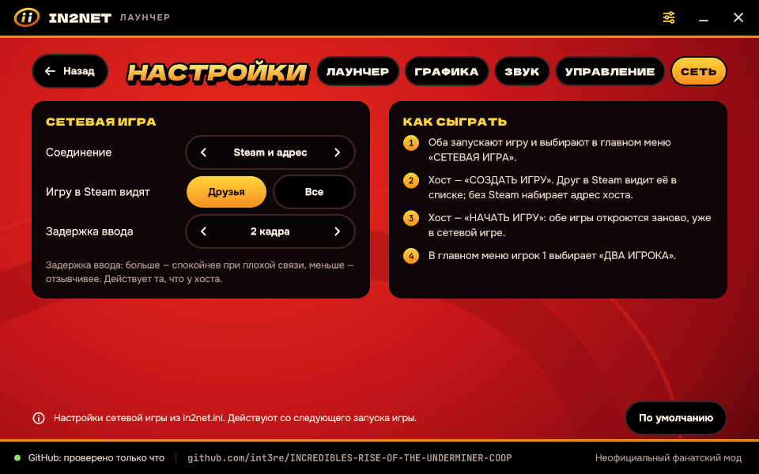
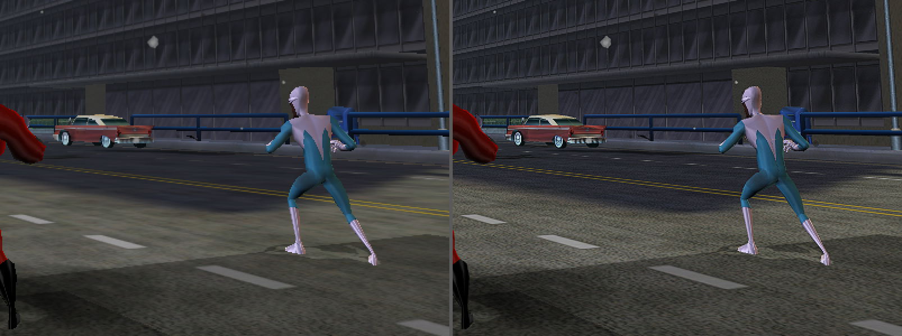
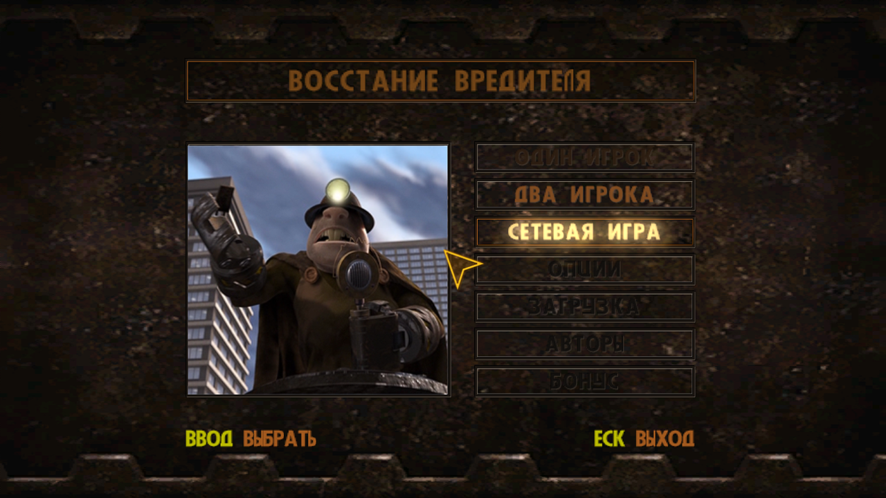

<h1 align="center">The Incredibles: Rise of the Underminer — Online Co-op</h1>

<p align="center">
  <b>in2net — network co-op for two for The Incredibles: Rise of the Underminer (PC, 2005)</b><br>
  One file · each player has a copy of the game, a screen and a camera of their own · Steam or a direct address · wide screen
</p>

<p align="center">
  
  
  
  
  
  
  
  
</p>

<p align="center">
  <a href="https://github.com/int3re/INCREDIBLES-RISE-OF-THE-UNDERMINER-COOP/releases/latest/download/in2net-launcher.exe"></a><br>
  <sub>One file of about 4.6 MB: the mod is inside the launcher. It installs the mod, keeps it up to date and starts the game.</sub>
</p>

<p align="center">
  <a href="README.md">Русский</a> · <b>English</b>
</p>

<p align="center">
  
</p>

**in2net** is a mod for the Russian PC release of *The Incredibles: Rise of the Underminer* («Суперсемейка:
Подземная битва»). The game has a mode for two players, but only at one computer. The mod gives the same
over the network: each player has a copy of the game, a screen and a camera of their own, and a network
game is started from the game's own main menu — in its font and in its look.

Along the way it brings a game of 2005 up to date: 60 frames a second instead of 31, a wide screen without
stretching, a window without a frame, smoothed edges and sharp textures, attacks on the mouse's buttons.

> The mod holds no files of the game and does not change `incrotu.exe` on the disk: everything is done in
> memory at the start. You need your own copy of the game. This is an unofficial fan mod; the version is
> an early one.

> **Language.** The mod and the launcher speak Russian, like the release of the game they are made for.
> The documentation gives every button and menu item as it is on the screen, with a translation.

**Other mods of the series:**
[TMNT (2003) — co-op for up to four](https://github.com/int3re/TMNT-2003-COOP) ·
[TMNT 2: Battle Nexus — co-op for up to four](https://github.com/int3re/TMNT-2-BATTLE-NEXUS-COOP) ·
[TMNT Mutant Melee — network play for up to four players](https://github.com/int3re/TMNT-MUTANT-MELEE-COOP)

## Contents

- [The launcher: one file](#the-launcher-one-file)
- [What the mod adds and changes](#what-the-mod-adds-and-changes)
- [The mod's menus](#the-mods-menus)
- [Features](#features)
- [Quick start](#quick-start)
- [Controls](#controls)
- [Requirements](#requirements)
- [Documentation](#documentation)
- [Versions and compatibility](#versions-and-compatibility)
- [Status](#status)
- [Building from source](#building-from-source)
- [How it works](#how-it-works)
- [Contributing](#contributing)
- [Credits](#credits)
- [Thank the author](#thank-the-author)
- [Licence and legal](#licence-and-legal)

## The launcher: one file

All there is to download is **[`in2net-launcher.exe`](https://github.com/int3re/INCREDIBLES-RISE-OF-THE-UNDERMINER-COOP/releases/latest/download/in2net-launcher.exe)**:
the mod is inside it, there is no separate installer. The launcher finds the game, puts the mod in, watches
for updates, sets the picture, the sound and the keys, and starts the game.

<table>
  <tr>
    <td align="center" width="33%"><br><b>1. Install</b><br><sub>The mod is inside: one button, no internet</sub></td>
    <td align="center" width="33%"><br><b>2. Play</b><br><sub>The files go next to the game; the game itself is not changed</sub></td>
    <td align="center" width="33%"><br><b>3. Update</b><br><sub>The launcher tells you of a new version itself</sub></td>
  </tr>
</table>

| What it does | How |
|---|---|
| **Finds the game** | by the game's record in Windows or in its own folder; if not, it asks where `incrotu.exe` is |
| **Installs the mod without internet** | the mod is inside the launcher; the game's files are not changed |
| **Updates with one button** | a new version is downloaded from GitHub, checked by size and SHA-256 and installed; settings, keys and saves stay |
| **Says whether you can play with friends** | under the versions it says whether their network protocol is the same |
| **Updates itself** | at its start it takes a newer launcher, checks it, puts it in its own place and starts again |
| **Sets the game up before it starts** | tabs ГРАФИКА (picture), ЗВУК (sound), УПРАВЛЕНИЕ (controls), СЕТЬ (network) |
| **Waits if the game is open** | or asks it to close, as the cross of its window does |
| **Works when GitHub opens badly** | tries Windows' settings, a VPN client on the same PC, or your proxy |
| **Removes the mod** | one button in the settings: exactly what was put in is removed |

<table>
  <tr>
    <td align="center" width="33%"><br><sub>The picture: window, wide frame, smoothing, sharpness</sub></td>
    <td align="center" width="33%"><br><sub>The sound: the game's sound and music levels</sub></td>
    <td align="center" width="33%"><br><sub>The controls: keys and mouse buttons of both players</sub></td>
  </tr>
  <tr>
    <td align="center" width="33%"><br><sub>The network: Steam or an address, the input delay</sub></td>
    <td align="center" width="33%"><br><sub>The launcher: updates, a proxy, logs, removing the mod, its "suit"</sub></td>
    <td align="center" width="33%"><br><sub>An update: download, check, install</sub></td>
  </tr>
</table>

More on the **[launcher's page](docs/en/LAUNCHER.md)**. Without a window, from the command line:
`in2net-launcher.exe /install "game folder" /quiet`.

## What the mod adds and changes

<p align="center">
  <br>
  <sub>On the left the original; on the right with the mod's smoothing, sharp textures and sharpness.</sub>
</p>

| | The original | With the mod |
|---|---|---|
| **Co-op** | two at one PC | the same over the network: Steam, a local network, IP |
| **Camera** | one for both | in a network game each has their own |
| **Speed of the game** | about 31 frames a second | 60 |
| **Wide screen** | the 4:3 frame stretched wide | more is seen at the sides, the interface and the menus in true proportions |
| **Window** | an exclusive full screen only | a window without a frame over the monitor, or an ordinary window; Alt+Tab at once |
| **Resolution** | from the list on the game's options screen | the monitor's, or any of your own |
| **Quality of the picture** | one checkbox of smoothing | smoothing up to 8x, texture filter 16x, sharpness, colours |
| **Buttons of the mouse** | left, right, middle; set only inside the game | the side ones too; set in the launcher, work in a network game |
| **Main menu** | ОДИН ИГРОК, ДВА ИГРОКА, ОПЦИИ, ЗАГРУЗКА, АВТОРЫ, БОНУС | СЕТЕВАЯ ИГРА (network game) added — third, under ДВА ИГРОКА (two players) |
| **Settings** | only on the game's options screen | in the launcher too, before the start: picture, sound, keys, network |
| **On a busy PC** | — | single player keeps its speed even if the PC cannot draw 60 frames |
| **Installing and updating** | — | one file: the [launcher](#the-launcher-one-file) installs the mod, updates it and starts the game |

All of it in pictures: **[What the mod adds and changes](docs/en/TOUR.md)**; what changed from version to
version: **[history of versions](docs/en/CHANGELOG.md)**.

## The mod's menus

Everything the mod adds to the game is made by the game's own means: its frames, its font, its highlight,
the same keys as in its other menus. The mod has no windows of its own over the game.

<table>
  <tr>
    <td align="center" width="50%"><br><sub>The main menu: СЕТЕВАЯ ИГРА is the third button; the seven fit the height of the picture</sub></td>
    <td align="center" width="50%"><br><sub>The СЕТЕВАЯ ИГРА page: make a game, join a friend's, start</sub></td>
  </tr>
</table>

Messages in a network game — who you are in it, that the other player has left, that the connection is
lost — are written by the game itself too, in its font, in two lines at the top of the frame.

## Features

### Network game


- **two players on two PCs** play the game as in its own two-player mode. Only the controls go over the
  network, no picture: there is no video lag, and the game runs frame for frame on both PCs;
- **Steam or an address**: Steam friends see each other's game in a list, and the host can invite from
  inside the game; without Steam the guest types the host's address (a local network, a forwarded port,
  Radmin VPN, Hamachi, ZeroTier);
- **meeting inside the game**: the СЕТЕВАЯ ИГРА item of the main menu and a page built of the game's own
  menu objects;
- **a camera of your own**: each sees their hero in the middle and large; the game's common camera is a
  switch away;
- **a common pause**: either player sets it;
- **common progress** is the host's; it is kept apart, the players' own saves are not touched;
- **the connection lives through** lost packets, a long level load and a window being dragged;
- **if the other player leaves**, or the connection is lost for more than 15 seconds, you go on alone;
- **the picture is each player's own**: resolution, the frame's shape, smoothing and sharpness do not
  change how the game plays.

<br clear="right">

### Screen and picture

- **60 frames a second** instead of about 31; the game's own settings screen is held to 60 as well;
- **a wide screen without stretching**: the frame has the monitor's shape, more is seen at the sides, the
  interface and the menus keep their proportions;
- **a window without a frame** over the monitor, or an ordinary window; the desktop's resolution is not
  changed;
- **smoothed edges** up to 8x, **sharp textures at an angle** up to 16x, **sharpness** of the finished
  frame, fuller colours on request;
- **the game does not slow down on a busy PC**: if the video card cannot draw 60 frames, single player
  runs at its real speed, like the original, and the sound is not torn.

### Controls and sound

- **buttons of the mouse**: an action can have one besides its key — left, right, middle and the two side
  ones (the game itself does not know the side ones; the mod adds them);
- **the keys of both players** are set in the launcher just as on the game's options screen, and are kept
  in the same place;
- **the sound and music levels** are in the launcher: a network game does not open the options screen.

## Quick start

1. Download **[`in2net-launcher.exe`](https://github.com/int3re/INCREDIBLES-RISE-OF-THE-UNDERMINER-COOP/releases/latest/download/in2net-launcher.exe)** and start it.
   It is the only file: the mod is inside it. All versions are on the [Releases](../../releases) page.
2. If the launcher has not found the game, show it the folder that holds `incrotu.exe`.
3. Press **УСТАНОВИТЬ МОД** (Install the mod), then **ИГРАТЬ** (Play). The game's main menu gets the item
   **СЕТЕВАЯ ИГРА** (Network game).

> The launcher is not signed with a certificate, so Windows may show "Windows protected your PC". Press
> **More info → Run anyway**.

Playing together:

| | The host (player 1) | The guest (player 2) |
|---|---|---|
| 1 | СЕТЕВАЯ ИГРА → **СОЗДАТЬ ИГРУ** (Make a game) | СЕТЕВАЯ ИГРА → the row **ИГРА: \<host's name\>** (Steam), or **АДРЕС** → the host's address → Enter |
| 2 | waits for the guest's name in the frame on the right | waits |
| 3 | **НАЧАТЬ ИГРУ** (Start the game) | both games close and open again a few seconds later, now in a network game |
| 4 | chooses **ДВА ИГРОКА** (Two players) in the main menu | the game begins by itself |

Over Steam: Steam runs at both players, and they are friends. Without Steam the guest needs a direct way
to the host over UDP, port `47820`. More in the **[guide to network play](docs/en/NETPLAY.md)**.

## Controls

The keys are the game's own. In a network game each player uses their own player-1 keys on their own PC.

| Action | Player 1 | Player 2 (two at one PC) |
|---|---|---|
| Move | W A S D | arrows |
| Jump | Space | Num 0 |
| Punch | O | Num 2 |
| Grab / freeze | I | Num 1 |
| Action | P | Num 3 |
| Super move, left / right | K / L | Num 7 / Num 9 |
| Upgrade | Left Shift | Backspace |
| Dodge forward / back / left / right | 8 / 9 / 7 / 0 | Num 8 / 5 / 4 / 6 |
| Partner (AI): swap / guard / attack / follow | 1 / 2 / 3 / 4 | Home / End / Delete / Page Down |
| Pause | Esc | Right Ctrl |

**A button of the mouse** is given to an action in the launcher: the tab УПРАВЛЕНИЕ → press the action's
cell → press the button you want on that same cell. The action gets it besides its key. The whole of it is
in [Controls](docs/en/CONTROLS.md).

## Requirements

- **Windows 10 or 11**;
- **your own copy of the game**: the Russian release «Суперсемейка: Подземная битва» with its `incrotu.exe`
  (SHA-256 `640aa731…6c70f320`). The launcher checks the file and warns if it is another one: with another
  file the mod changes nothing;
- for a game over Steam: the Steam client running and any account; nothing has to be bought;
- for a game by address over the internet: UDP port `47820` open at the host, or a common virtual network.

## Documentation

| Page | What it is about |
|---|---|
| [What the mod adds and changes](docs/en/TOUR.md) | a tour in pictures: the game's menus, a network game, the launcher |
| [Install](docs/en/INSTALL.md) | what you need, installing, updating, removing; what is put where |
| [The launcher](docs/en/LAUNCHER.md) | every screen and tab, updates, a proxy for GitHub, the command line |
| [Network play](docs/en/NETPLAY.md) | meeting over Steam or by address, the rules of a network game, lost connections |
| [Controls](docs/en/CONTROLS.md) | the keys of both players, the mouse's buttons, how to change them |
| [Settings](docs/en/SETTINGS.md) | the launcher's rows, the whole of `in2net.ini`, the game's own settings |
| [If something is wrong](docs/en/TROUBLESHOOTING.md) | frequent questions and what to send with a report |
| [History of versions](docs/en/CHANGELOG.md) | what changed from version to version |
| [Building](docs/en/BUILDING.md) | building the mod and the launcher from source, releases, the test lab |
| [How it works](docs/en/ARCHITECTURE.md) | lockstep, the game's clock, hooks, the native menus, the modules |

All of it is in **[Russian](docs/README.md)** too.

## Versions and compatibility

The current version of the mod is **0.5.2**, of the launcher **1.2.0**. The launcher shows the version of
the mod in the game's folder.

In a network game both players need versions with the same network protocol: the game has to run the same
on two PCs, so any change in how it runs changes the protocol too. The host refuses a guest with another
version, another `incrotu.exe` or another `data\in2.ini`, and the guest sees why on the page.

| Versions of the mod | Protocol | Play together |
|---|---|---|
| 0.3.0 – 0.5.2 | 4 | yes |
| 0.2.1 | 3 | only with 0.2.1 |
| 0.2.0 | 2 | only with 0.2.0 |
| 0.1.0 | 1 | only with 0.1.0 |

## Status

The mod is an early version: it was made and checked in a lab — on two copies of the game on one computer,
with no window on the screen. What has been checked by real play and what has not:

- **checked in the lab:** a network game by address and through a stand-in for Steam, with lost packets,
  breaks of the connection and long loads; the two games' logs matched frame for frame;
- **checked in a real run:** the launcher and its settings, starting the game, the main menu, the
  СЕТЕВАЯ ИГРА page with a real Steam (a game for friends is made); updating the launcher and the mod from
  the real GitHub;
- **not checked yet:** a whole game between two real Steam accounts; the mouse's buttons with a real mouse
  in the game's window; gamepads; cut scenes and special scenes in a network game.

Known limits:

- there is no joining a game that is already going, and no coming back after the connection is lost;
- in a network game a slow PC slows the game for both: the two games make every step together;
- while the other player's game is busy with a long load, yours stands and waits with no message;
- if the camera of your own looks the wrong way somewhere, it can be turned off (ГРАФИКА → «Камера в
  сети»: «Общая»);
- the mod is made for one edition of the game; the mod and the launcher speak Russian.

## Building from source

You need Windows, Visual Studio with the C++ tools, and CMake. The build is 32-bit only: `incrotu.exe` is
a 32-bit process.

```bash
cmake -S . -B build -A Win32
```

```bash
cmake --build build --config Release
```

The files and the launcher appear in `build/dist/Release`. ENet and Ultimate ASI Loader are taken from a
neighbouring checkout of [TMNT-2003-COOP](https://github.com/int3re/TMNT-2003-COOP); the Steamworks SDK is
optional. All of that, releases and the lab: [docs/en/BUILDING.md](docs/en/BUILDING.md).

## How it works

The mod is `in2net.asi`, loaded into the game's process by
[Ultimate ASI Loader](https://github.com/ThirteenAG/Ultimate-ASI-Loader) (`winmm.dll`). At the start the mod
checks the SHA-256 of `incrotu.exe` and only then puts its hooks in; with any other file it touches nothing.

A network game is deterministic lockstep. Each PC plays the whole game, and only the controls go over the
network: no PC plays a frame until it has the other player's controls for it. The same controls give the
same game, so enemies, physics and objects need not be sent. Twice a second the games compare a
fingerprint of the state. To make the game run the same, the mod gives it a clock of its own — 1/60 s a
frame — and looks after everything that could part two copies: the camera, the loading of levels, the mouse.

The mod's menus are the game's own data: the mod hands the engine copies of its own menu objects with
other names, places and links, and the engine itself makes them, draws them and walks them.

The launcher is a program of its own with no dependencies: Direct2D and DirectWrite for the picture,
WinHTTP for the network. The mod's files are in its resources. A new version comes as a new launcher: it
is downloaded, checked by the SHA-256 the release names, and opened as data, not run.

More in [docs/en/ARCHITECTURE.md](docs/en/ARCHITECTURE.md).

## Contributing

Reports and suggestions go to [Issues](../../issues). Attach `in2net.log` and `in2net-menu.log` from the
game's folder of **both PCs**: without the other side's log a network error can rarely be found. Look the
logs through before posting: they hold your Steam name and the game's folder.

How to propose a change and check it with no window on the screen: [CONTRIBUTING.en.md](CONTRIBUTING.en.md)
and [docs/en/BUILDING.md](docs/en/BUILDING.md).

## Credits

| Whom | For what | Licence |
|---|---|---|
| [Ultimate ASI Loader](https://github.com/ThirteenAG/Ultimate-ASI-Loader) (ThirteenAG) | loading the mod into the game | MIT |
| [MinHook](https://github.com/TsudaKageyu/minhook) (Tsuda Kageyu) | x86 function hooks | BSD 2-Clause |
| [ENet](https://github.com/lsalzman/enet) (Lee Salzman) | UDP with reliable and unreliable channels | MIT |
| [Steamworks SDK](https://partner.steamgames.com/) (Valve) | the network over Steam; not a part of the repository | Valve's licence |
| [Dela Gothic One](https://github.com/syakuzen/DelaGothic), [Onest](https://github.com/googlefonts/onest), [JetBrains Mono](https://github.com/JetBrains/JetBrainsMono) | the launcher's fonts | SIL OFL 1.1 |
| [Ghidra](https://ghidra-sre.org/) and [Capstone](https://www.capstone-engine.org/) | the tools the game was studied with | Apache 2.0, BSD |
| [coop-anything](https://github.com/cranebeaker/coop-anything) | ways of testing network mods | — |
| The [TMNT 2003](https://github.com/int3re/TMNT-2003-COOP) and [TMNT 2](https://github.com/int3re/TMNT-2-BATTLE-NEXUS-COOP) mods | the launcher, the network transport and the lab grew out of them | MIT |

Special thanks to **Heavy Iron Studios** for the game itself, to **Beenox** for its PC version, and to
everybody who plays with the mod and sends logs: network errors cannot be found without them.

## Thank the author

The mod is free. If it was of use to you and you would like to say thanks, you can send **USDT** to one of
these addresses:

| Network | Wallet address (USDT) |
|---|---|
| **TRON (TRC20)** | `TVdy7i7qoF1ZdrnNSZaC5Mgz1ZddaMhw4y` |
| **The Open Network (TON)** | `UQB-oxQVLLN3hm-YRGfr5-XJ95P0zIAeLFstgG40HiaR8oMz` |
| **BNB Smart Chain (BEP20)** | `0xA11f8221952FA5f540bC528072213b14F124379B` |

- The smallest amount is **0.1 USDT**.
- Send USDT only, and only over the network whose address you chose: another coin or another network will
  not arrive.
- The USDT contract on BNB Smart Chain:
  [`0x55d398326f99059fF775485246999027B3197955`](https://bscscan.com/token/0x55d398326f99059fF775485246999027B3197955).

Thanks need not be money: a star for the repository, a report of a problem or a log after a game help too.

## Licence and legal

The mod's code is under the [MIT](LICENSE) licence. Third-party libraries keep their own: MinHook — BSD
2-Clause, ENet — MIT, Ultimate ASI Loader — MIT, the launcher's fonts — SIL Open Font License 1.1 (the
licences' texts are in [src/launcher/assets/fonts](src/launcher/assets/fonts)). The game, its files and its
art are not covered by the mod's licence.

This is an unofficial fan project. It is not affiliated with or endorsed by Disney, Pixar, THQ, Heavy Iron
Studios, Beenox or any other rights holder. *The Incredibles* and related names and characters are
trademarks of their owners. The repository and the releases hold no files of the game: the mod needs your
own copy. Screenshots show the mod at work and are here for illustration; the players' names in them are
made up. The launcher's look is its own: there is no logo or character of the film or the game in it.

To work over Steam the mod uses the identifier of Valve's test application Spacewar (AppID 480), so Steam
shows the status "Spacewar" during a network game.
