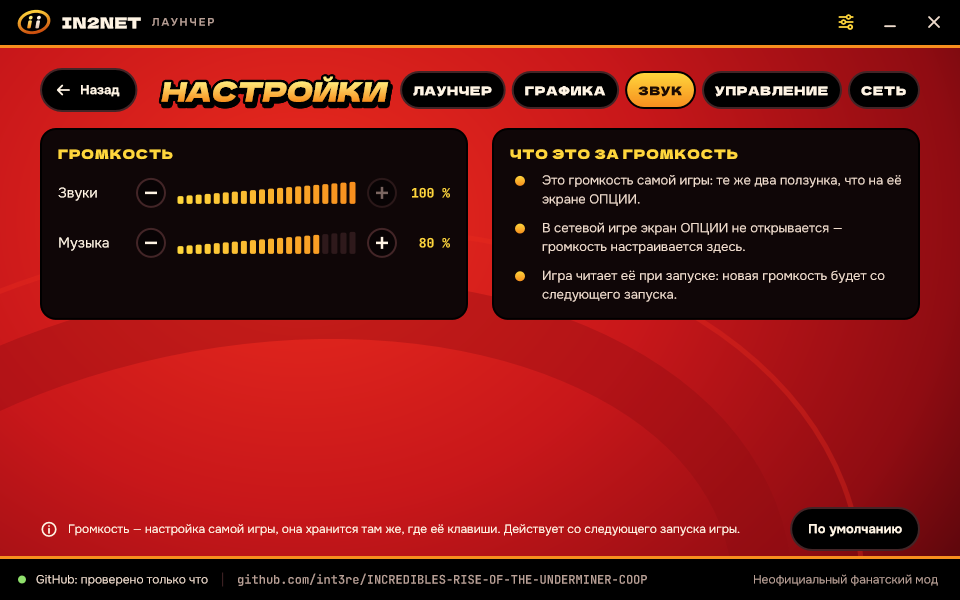
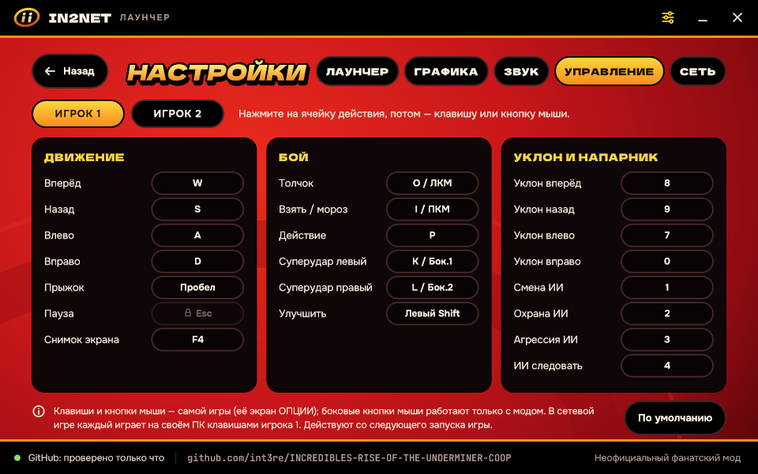
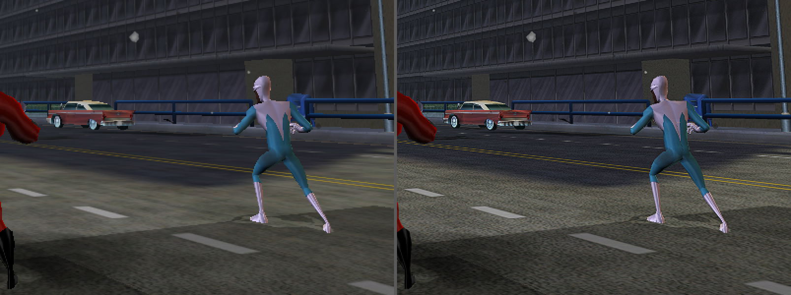
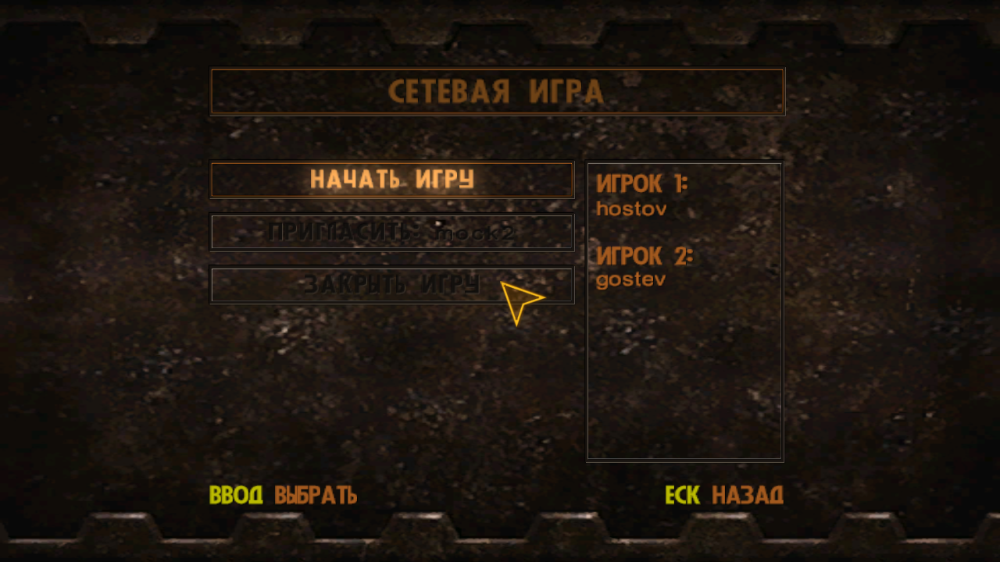

<h1 align="center">Суперсемейка: Подземная битва — кооператив по сети</h1>

<p align="center">
  <b>in2net — сетевой кооператив на двоих для The Incredibles: Rise of the Underminer (ПК, 2005)</b><br>
  Один файл · у каждого своя копия игры, свой экран и своя камера · Steam или прямой адрес · широкий экран
</p>

<p align="center">
  
  
  
  
  
  
  
  
</p>

<p align="center">
  <a href="https://github.com/int3re/INCREDIBLES-RISE-OF-THE-UNDERMINER-COOP/releases/latest/download/in2net-launcher.exe"></a><br>
  <sub>Один файл, около 4,6 МБ: мод лежит внутри лаунчера. Он ставит мод, обновляет его и запускает игру.</sub>
</p>

<p align="center">
  <b>Русский</b> · <a href="README.en.md">English</a>
</p>

<p align="center">
  
</p>

**in2net** — мод для русского издания игры «Суперсемейка: Подземная битва» (*The Incredibles: Rise of the
Underminer*). В игре есть режим «ДВА ИГРОКА», но только за одним компьютером. Мод даёт то же самое по сети:
у каждого игрока своя копия игры, свой экран и своя камера, а сетевая игра начинается из главного меню самой
игры — её шрифтом и в её оформлении.

Заодно мод приводит игру 2005 года к сегодняшним меркам: 60 кадров в секунду вместо 31, широкий экран без
растяжения, окно без рамки, сглаживание и чёткие текстуры, удары на кнопках мыши.

> Мод не содержит файлов игры и не меняет `incrotu.exe` на диске: все изменения делаются в памяти при запуске.
> Нужна своя копия игры. Это неофициальный фанатский мод; версия пробная.

**Другие моды этой серии:**
[TMNT (2003) — кооператив до четырёх игроков](https://github.com/int3re/TMNT-2003-COOP) ·
[TMNT 2: Battle Nexus — кооператив до четырёх игроков](https://github.com/int3re/TMNT-2-BATTLE-NEXUS-COOP)

## Содержание

- [Лаунчер: один файл](#лаунчер-один-файл)
- [Что добавлено и что изменено](#что-добавлено-и-что-изменено)
- [Меню мода](#меню-мода)
- [Возможности](#возможности)
- [Быстрый старт](#быстрый-старт)
- [Управление](#управление)
- [Что нужно для игры](#что-нужно-для-игры)
- [Документация](#документация)
- [Версии и совместимость](#версии-и-совместимость)
- [Состояние проекта](#состояние-проекта)
- [Сборка из исходников](#сборка-из-исходников)
- [Как это работает](#как-это-работает)
- [Участие](#участие)
- [Благодарности](#благодарности)
- [Поблагодарить автора](#поблагодарить-автора)
- [Лицензия и права](#лицензия-и-права)

## Лаунчер: один файл

Скачать нужно только **[`in2net-launcher.exe`](https://github.com/int3re/INCREDIBLES-RISE-OF-THE-UNDERMINER-COOP/releases/latest/download/in2net-launcher.exe)**:
мод лежит внутри него, отдельного установщика нет. Лаунчер находит игру, ставит мод, следит за обновлениями,
настраивает картинку, звук и клавиши и запускает игру.

<table>
  <tr>
    <td align="center" width="33%"><br><b>1. Установить</b><br><sub>Мод уже внутри: ставится одной кнопкой, без интернета</sub></td>
    <td align="center" width="33%"><br><b>2. Играть</b><br><sub>Файлы ложатся рядом с игрой, сама игра не меняется</sub></td>
    <td align="center" width="33%"><br><b>3. Обновлять</b><br><sub>О новой версии лаунчер скажет сам</sub></td>
  </tr>
</table>

| Что он делает | Как |
|---|---|
| **Находит игру** | по записи игры в Windows или в своей папке; не нашёл — спросит, где лежит `incrotu.exe` |
| **Ставит мод без интернета** | мод лежит внутри лаунчера; файлы игры не меняются |
| **Обновляет одной кнопкой** | новая версия скачивается с GitHub, сверяется по размеру и SHA-256 и ставится; настройки, клавиши и сохранения остаются |
| **Говорит, можно ли играть с друзьями** | под версиями написано, тот же ли у них сетевой протокол |
| **Обновляет и себя** | при запуске сам берёт лаунчер новее, сверяет его, встаёт на его место и перезапускается |
| **Настраивает игру до запуска** | вкладки ГРАФИКА, ЗВУК, УПРАВЛЕНИЕ и СЕТЬ: картинка, громкость, клавиши и кнопки мыши, сетевая игра |
| **Ждёт, если игра открыта** | или сам попросит её закрыться, как крестик её окна |
| **Работает, когда GitHub открывается плохо** | пробует настройки Windows, VPN-клиент на этом же ПК или ваш прокси |
| **Убирает мод** | одной кнопкой в настройках: удаляется ровно то, что было поставлено |

<table>
  <tr>
    <td align="center" width="33%"><br><sub>ГРАФИКА: окно, широкий кадр, сглаживание, резкость</sub></td>
    <td align="center" width="33%"><br><sub>ЗВУК: громкость звуков и музыки игры</sub></td>
    <td align="center" width="33%"><br><sub>УПРАВЛЕНИЕ: клавиши и кнопки мыши обоих игроков</sub></td>
  </tr>
  <tr>
    <td align="center" width="33%"><br><sub>СЕТЬ: Steam или адрес, задержка ввода</sub></td>
    <td align="center" width="33%"><br><sub>ЛАУНЧЕР: обновления, прокси, журналы, удаление мода, «костюм»</sub></td>
    <td align="center" width="33%"><br><sub>Обновление: загрузка, сверка, установка</sub></td>
  </tr>
</table>

Подробно — на **[странице лаунчера](docs/LAUNCHER.md)**. Без окна, из командной строки:
`in2net-launcher.exe /install "папка игры" /quiet`.

## Что добавлено и что изменено

<p align="center">
  <br>
  <sub>Слева — как в оригинале, справа — со сглаживанием, чёткими текстурами и резкостью мода.</sub>
</p>

| | В оригинале | С модом |
|---|---|---|
| **Кооператив** | двое за одним ПК | то же по сети: Steam, локальная сеть, IP |
| **Камера** | одна на двоих | в сети у каждого своя |
| **Скорость игры** | около 31 кадра в секунду | 60 |
| **Широкий экран** | кадр 4:3 растянут вширь | обзор шире, интерфейс и меню в верных пропорциях |
| **Окно** | только полный экран поверх всего | окно без рамки на весь монитор или обычное окно; Alt+Tab сразу |
| **Разрешение** | из списка в ОПЦИЯХ игры | по монитору или любое своё |
| **Качество картинки** | одна галочка сглаживания | сглаживание до 8x, фильтр текстур 16x, резкость, цвета |
| **Кнопки мыши** | левая, правая, средняя; назначаются только в игре | ещё и боковые; назначаются в лаунчере, работают и в сетевой игре |
| **Главное меню** | ОДИН ИГРОК, ДВА ИГРОКА, ОПЦИИ, ЗАГРУЗКА, АВТОРЫ, БОНУС | добавлена СЕТЕВАЯ ИГРА — третьей, под ДВА ИГРОКА |
| **Настройки** | только на экране ОПЦИИ в игре | ещё и в лаунчере, до запуска: графика, звук, клавиши, сеть |
| **На занятом ПК** | — | одиночная игра держит свою скорость, даже если ПК не успевает рисовать 60 кадров |
| **Установка и обновления** | — | один файл: [лаунчер](#лаунчер-один-файл) ставит мод, обновляет его и запускает игру |

Всё это в картинках — на странице **[«Что добавлено и что изменено»](docs/TOUR.md)**; что менялось от версии
к версии — в **[истории версий](docs/CHANGELOG.md)**.

## Меню мода

Всё, что мод добавляет в игру, сделано средствами самой игры: её рамки, её шрифт, её подсветка, те же клавиши,
что и в остальных меню. Своих окон поверх игры у мода нет.

<table>
  <tr>
    <td align="center" width="50%"><br><sub>Главное меню: СЕТЕВАЯ ИГРА — третья кнопка, семь кнопок уложены в высоту картинки</sub></td>
    <td align="center" width="50%"><br><sub>Страница СЕТЕВАЯ ИГРА: создать игру, войти к другу, начать</sub></td>
  </tr>
</table>

Сообщения в сетевой игре — кто вы в ней, что второй игрок вышел или связь пропала — тоже пишет сама игра,
своим шрифтом, двумя строками вверху кадра.

## Возможности

### Сетевая игра


- **двое с разных ПК** проходят игру так же, как в штатном режиме «ДВА ИГРОКА». По сети идут только нажатия,
  картинка не передаётся: задержки видео нет, игра на обоих ПК идёт кадр в кадр;
- **Steam или адрес**: друзья в Steam видят игру друг друга в списке, хост может послать приглашение прямо из
  игры; без Steam гость набирает адрес хоста (локальная сеть, проброс порта, Radmin VPN, Hamachi, ZeroTier);
- **встреча в самой игре**: пункт СЕТЕВАЯ ИГРА в главном меню и страница, собранная из объектов меню игры;
- **своя камера у каждого**: каждый видит своего героя в центре и крупно; при желании — общая камера игры;
- **общая пауза**: её ставит любой из игроков;
- **общий прогресс** — у хоста; он хранится отдельно, собственные сохранения игроков мод не трогает;
- **связь переживает** потерю пакетов, долгую загрузку уровня и перетаскивание окна;
- **если второй игрок вышел** или связь пропала дольше чем на 15 секунд, вы продолжаете один;
- **картинка у каждого своя**: разрешение, форма кадра, сглаживание и резкость на ход игры не влияют.

<br clear="right">

### Экран и картинка

- **60 кадров в секунду** вместо примерно 31; экран настроек самой игры тоже держится на 60;
- **широкий экран без растяжения**: кадр по форме монитора, обзор шире по бокам, интерфейс и меню в своих
  пропорциях;
- **окно без рамки** на весь монитор или обычное окно; разрешение рабочего стола не меняется;
- **сглаживание краёв** до 8x, **чёткие текстуры под углом** до 16x, **резкость** готового кадра, при желании —
  более сочные цвета;
- **игра не замедляется на занятом ПК**: если видеокарта не успевает рисовать 60 кадров, одиночная игра идёт в
  настоящем темпе, как оригинал, а звук не рвётся.

### Управление и звук

- **кнопки мыши**: действию можно дать кнопку мыши в придачу к клавише — левую, правую, среднюю и обе боковые
  (боковые сама игра не понимает, их добавляет мод);
- **клавиши обоих игроков** назначаются в лаунчере так же, как на экране ОПЦИИ игры, и хранятся там же;
- **громкость звуков и музыки** — в лаунчере: в сетевой игре экран ОПЦИИ не открывается.

## Быстрый старт

1. Скачайте **[`in2net-launcher.exe`](https://github.com/int3re/INCREDIBLES-RISE-OF-THE-UNDERMINER-COOP/releases/latest/download/in2net-launcher.exe)** и запустите.
   Это единственный файл: мод лежит внутри него. Все версии — на странице [Releases](../../releases).
2. Если лаунчер не нашёл игру сам, укажите папку, где лежит `incrotu.exe`.
3. Нажмите **УСТАНОВИТЬ МОД**, потом **ИГРАТЬ**. В главном меню игры появится пункт **СЕТЕВАЯ ИГРА**.

> Лаунчер не подписан сертификатом, поэтому Windows может показать «Система Windows защитила ваш
> компьютер». Нажмите «Подробнее» → «Выполнить в любом случае».

Играть вместе:

| | Хост (игрок 1) | Гость (игрок 2) |
|---|---|---|
| 1 | СЕТЕВАЯ ИГРА → **СОЗДАТЬ ИГРУ** | СЕТЕВАЯ ИГРА → строка **ИГРА: имя хоста** (Steam) или **АДРЕС** → адрес хоста → Ввод |
| 2 | ждёт, пока имя гостя появится в рамке справа | ждёт |
| 3 | **НАЧАТЬ ИГРУ** | обе игры закрываются и через несколько секунд открываются снова — уже в сетевой игре |
| 4 | в главном меню выбирает **ДВА ИГРОКА** | игра начинается сама |

Через Steam: Steam запущен у обоих, игроки — друзья. Без Steam гостю нужна прямая связь до хоста по UDP, порт
`47820`. Подробно — в **[руководстве по сетевой игре](docs/NETPLAY.md)**.

## Управление

Клавиши — самой игры. В сетевой игре каждый играет на своём ПК клавишами игрока 1.

| Действие | Игрок 1 | Игрок 2 (двое за одним ПК) |
|---|---|---|
| Ходить | W A S D | стрелки |
| Прыжок | Пробел | Цифр. 0 |
| Толчок | O | Цифр. 2 |
| Взять / мороз | I | Цифр. 1 |
| Действие | P | Цифр. 3 |
| Суперудар левый / правый | K / L | Цифр. 7 / Цифр. 9 |
| Улучшить | Левый Shift | Backspace |
| Уклон вперёд / назад / влево / вправо | 8 / 9 / 7 / 0 | Цифр. 8 / 5 / 4 / 6 |
| Напарник (ИИ): смена / охрана / агрессия / следовать | 1 / 2 / 3 / 4 | Home / End / Delete / Page Down |
| Пауза | Esc | Правый Ctrl |

**Кнопка мыши** даётся действию в лаунчере: вкладка УПРАВЛЕНИЕ → нажать на ячейку действия → на ней же нажать
нужную кнопку мыши. Действие получит её в придачу к клавише. Полное описание — в
[описании управления](docs/CONTROLS.md).

## Что нужно для игры

- **Windows 10 или 11**;
- **своя копия игры**: русское издание «Суперсемейка: Подземная битва» с `incrotu.exe`
  (SHA-256 `640aa731…6c70f320`). Лаунчер проверяет файл и предупреждает, если он другой: с другим файлом мод
  ничего не меняет;
- для игры через Steam — запущенный Steam и любая учётная запись; покупать ничего не нужно;
- для игры по адресу через интернет — открытый у хоста порт `47820` UDP или общая виртуальная сеть.

## Документация

| Страница | О чём |
|---|---|
| [Что добавлено и что изменено](docs/TOUR.md) | обзор в картинках: меню игры, сетевая игра, лаунчер |
| [Установка](docs/INSTALL.md) | что нужно, установка, обновление, удаление, что и куда ставится |
| [Лаунчер](docs/LAUNCHER.md) | все экраны и вкладки, обновления, прокси для GitHub, командная строка |
| [Сетевая игра](docs/NETPLAY.md) | как собраться через Steam или по адресу, правила сетевой игры, обрывы связи |
| [Управление](docs/CONTROLS.md) | клавиши обоих игроков, кнопки мыши, как их менять |
| [Настройки](docs/SETTINGS.md) | строки лаунчера, весь `in2net.ini`, настройки самой игры |
| [Если что-то не так](docs/TROUBLESHOOTING.md) | частые вопросы и что прислать в отчёте об ошибке |
| [История версий](docs/CHANGELOG.md) | что менялось от версии к версии |
| [Сборка](docs/BUILDING.md) | как собрать мод и лаунчер из исходников, релизы, лаборатория |
| [Как это устроено](docs/ARCHITECTURE.md) | lockstep, часы игры, перехваты, родные меню, модули |

Вся документация есть и **[на английском](docs/en/README.md)**.

## Версии и совместимость

Текущая версия мода — **0.5.2**, лаунчера — **1.2.0**. Версию мода в папке игры показывает лаунчер.

В сетевой игре у обоих должна быть версия мода с одним сетевым протоколом: игра на двух ПК обязана идти
одинаково, поэтому любое изменение в её ходе меняет и протокол. Хост сам откажет гостю с другой версией,
другим `incrotu.exe` или другим `data\in2.ini`, а гость увидит причину на странице.

| Версии мода | Протокол | Играют вместе |
|---|---|---|
| 0.3.0 – 0.5.2 | 4 | да |
| 0.2.1 | 3 | только с 0.2.1 |
| 0.2.0 | 2 | только с 0.2.0 |
| 0.1.0 | 1 | только с 0.1.0 |

## Состояние проекта

Мод пробный: он сделан и проверен в лаборатории — на двух копиях игры на одном компьютере, без окна на
экране. Что проверено настоящей игрой, а что нет:

- **проверено в лаборатории:** сетевая игра по адресу и через замену Steam, с потерей пакетов, обрывами связи
  и долгими загрузками; журналы двух игр совпадали кадр в кадр;
- **проверено настоящим запуском:** лаунчер и его настройки, запуск игры, главное меню, страница СЕТЕВАЯ ИГРА
  с настоящим Steam (игра для друзей создаётся); обновление лаунчера и мода с настоящего GitHub;
- **ещё не проверено:** целая игра между двумя настоящими аккаунтами Steam; кнопки мыши настоящей мышью в
  окне игры; геймпады; ролики и особые сцены в сетевой игре.

Известные ограничения:

- нет входа в уже идущую игру и возврата после обрыва связи;
- в сетевой игре медленный ПК замедляет игру у обоих: шаги игры у игроков общие;
- пока игра второго игрока занята долгой загрузкой, ваша стоит и ждёт без сообщения на экране;
- если своя камера где-то смотрит не туда, её можно выключить (ГРАФИКА → «Камера в сети»: «Общая»);
- мод сделан для одного издания игры; надписи мода и лаунчера — на русском языке.

## Сборка из исходников

Нужны Windows, Visual Studio с инструментами C++ и CMake. Сборка только 32-битная: `incrotu.exe` — 32-битный
процесс.

```bash
cmake -S . -B build -A Win32
```

```bash
cmake --build build --config Release
```

Готовые файлы и лаунчер появятся в `build/dist/Release`. ENet и Ultimate ASI Loader берутся из соседней папки
с [TMNT-2003-COOP](https://github.com/int3re/TMNT-2003-COOP); Steamworks SDK — по желанию. Всё это, релизы и
лаборатория — в [docs/BUILDING.md](docs/BUILDING.md).

## Как это работает

Мод — это `in2net.asi`, который [Ultimate ASI Loader](https://github.com/ThirteenAG/Ultimate-ASI-Loader)
(`winmm.dll`) загружает в процесс игры. При старте мод сверяет SHA-256 файла `incrotu.exe` и только потом
ставит перехваты; с любым другим файлом он ничего не трогает.

Сетевая игра — детерминированный lockstep («шаг в ногу»). Каждый ПК выполняет полную игру, а по сети идёт
только ввод: ни один ПК не выполняет кадр, пока не получит нажатия второго игрока для него. Одинаковый ввод
даёт одинаковую игру, поэтому врагов, физику и предметы передавать не нужно. Дважды в секунду игры сверяют
отпечаток состояния. Чтобы игра шла одинаково, мод даёт ей свои часы — 1/60 секунды на кадр — и следит за
всем, что могло бы развести две копии: камерой, загрузкой уровней, мышью.

Меню мода — данные самой игры: мод подсовывает движку копии его же объектов меню с другими именами, местами
и связями, а создаёт, рисует и обходит их сам движок.

Лаунчер — отдельная программа без зависимостей: Direct2D и DirectWrite для картинки, WinHTTP для сети. Файлы
мода лежат в его ресурсах. Новая версия приходит как новый лаунчер: он скачивается, сверяется по SHA-256 из
релиза и открывается как данные, а не запускается.

Подробности — в [docs/ARCHITECTURE.md](docs/ARCHITECTURE.md).

## Участие

Сообщения об ошибках и предложения — в [Issues](../../issues). К сообщению приложите `in2net.log` и
`in2net-menu.log` из папки игры **с обоих ПК**: без журнала второй стороны сетевую ошибку обычно не найти.
Перед публикацией просмотрите журналы: в них есть ваше имя в Steam и папка игры.

Как предложить изменение и как проверить его без окна на экране — в [CONTRIBUTING.md](CONTRIBUTING.md) и
[docs/BUILDING.md](docs/BUILDING.md).

## Благодарности

| Кому | За что | Лицензия |
|---|---|---|
| [Ultimate ASI Loader](https://github.com/ThirteenAG/Ultimate-ASI-Loader) (ThirteenAG) | загрузка мода в игру | MIT |
| [MinHook](https://github.com/TsudaKageyu/minhook) (Tsuda Kageyu) | перехваты функций x86 | BSD 2-Clause |
| [ENet](https://github.com/lsalzman/enet) (Lee Salzman) | сеть по UDP с надёжным и ненадёжным каналами | MIT |
| [Steamworks SDK](https://partner.steamgames.com/) (Valve) | сеть через Steam; в репозиторий не входит | лицензия Valve |
| [Dela Gothic One](https://github.com/syakuzen/DelaGothic), [Onest](https://github.com/googlefonts/onest), [JetBrains Mono](https://github.com/JetBrains/JetBrainsMono) | шрифты лаунчера | SIL OFL 1.1 |
| [Ghidra](https://ghidra-sre.org/) и [Capstone](https://www.capstone-engine.org/) | инструменты, которыми разбиралась игра | Apache 2.0, BSD |
| [coop-anything](https://github.com/cranebeaker/coop-anything) | приёмы тестирования сетевых модов | — |
| Моды [TMNT 2003](https://github.com/int3re/TMNT-2003-COOP) и [TMNT 2](https://github.com/int3re/TMNT-2-BATTLE-NEXUS-COOP) | лаунчер, сетевой транспорт и лаборатория выросли из них | MIT |

Отдельное спасибо **Heavy Iron Studios** за саму игру, **Beenox** — за её версию для ПК, и всем, кто играет
с модом и присылает журналы: без них сетевые ошибки не найти.

## Поблагодарить автора

Мод бесплатный. Если он вам пригодился и хочется сказать спасибо, можно перевести **USDT** на один из адресов:

| Сеть | Адрес кошелька (USDT) |
|---|---|
| **TRON (TRC20)** | `TVdy7i7qoF1ZdrnNSZaC5Mgz1ZddaMhw4y` |
| **The Open Network (TON)** | `UQB-oxQVLLN3hm-YRGfr5-XJ95P0zIAeLFstgG40HiaR8oMz` |
| **BNB Smart Chain (BEP20)** | `0xA11f8221952FA5f540bC528072213b14F124379B` |

- Минимальная сумма — **0,1 USDT**.
- Отправляйте только USDT и только в той сети, чей адрес выбрали: перевод другой монеты или по другой сети
  не дойдёт.
- Контракт USDT в сети BNB Smart Chain:
  [`0x55d398326f99059fF775485246999027B3197955`](https://bscscan.com/token/0x55d398326f99059fF775485246999027B3197955).

Сказать спасибо можно и без денег: звездой репозиторию, сообщением об ошибке или журналом после игры.

## Лицензия и права

Код мода распространяется по лицензии [MIT](LICENSE). Сторонние библиотеки сохраняют свои лицензии:
MinHook — BSD 2-Clause, ENet — MIT, Ultimate ASI Loader — MIT, шрифты лаунчера — SIL Open Font License 1.1
(тексты лицензий — в [src/launcher/assets/fonts](src/launcher/assets/fonts)). Игра, её файлы и её графика
лицензией мода не покрываются.

Это неофициальный фанатский проект. Он не связан с Disney, Pixar, THQ, Heavy Iron Studios, Beenox и другими
правообладателями и ими не одобрен. *The Incredibles*, «Суперсемейка» и связанные названия и персонажи —
товарные знаки их владельцев. Репозиторий и релизы не содержат файлов игры: для работы мода нужна ваша
собственная копия. Снимки экрана показывают работу мода и приведены для иллюстрации; имена игроков на них
вымышлены. Оформление лаунчера — собственное: логотипа и персонажей фильма и игры в нём нет.

Для работы через Steam мод использует идентификатор тестового приложения Valve Spacewar (AppID 480), поэтому
во время сетевой игры Steam показывает статус «Spacewar».
