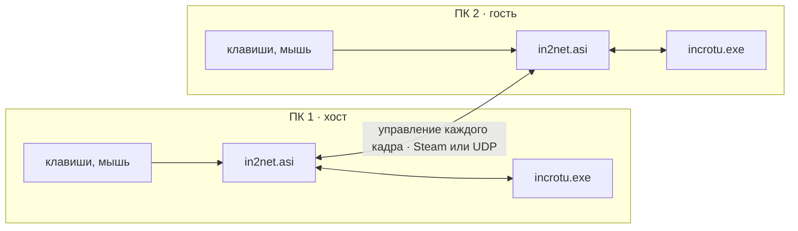

# Как это устроено

[Документация](README.md) · [Сборка](BUILDING.md) · [История версий](CHANGELOG.md)

**Русский** · [English](en/ARCHITECTURE.md)

in2net — это две программы: **мод**, `in2net.asi`, который живёт внутри процесса игры, и **лаунчер**,
который в игру не попадает вообще.

## Как мод попадает в игру

- При запуске игра импортирует `winmm.dll`. В папке игры под этим именем лежит
  [Ultimate ASI Loader](https://github.com/ThirteenAG/Ultimate-ASI-Loader): он загружает `in2net.asi`, а всё
  остальное передаёт настоящей `winmm.dll` из Windows.
- `incrotu.exe` упакован: когда мод загружается, кода игры в памяти ещё нет. `boot.cpp` ждёт первого
  вызова, который делает код самой игры, и только тогда ставит хуки.
- Мод сверяет SHA-256 файла `incrotu.exe`. Если файл ему незнаком, он не ставит ни одного хука.
- Хуки — это трамплины [MinHook](https://github.com/TsudaKageyu/minhook) (`patch.cpp`). Перед тем как
  поставить хук на функцию игры, её первые байты сравниваются с теми, какими они должны быть; если они
  другие, эта возможность остаётся за игрой, и в журнале об этом написано. На диске ничего не меняется.

Адреса и структуры, которыми пользуется мод, собраны в одном файле, `src/mod/game.h`, у каждой —
пояснение.

## Время: одинаковое на каждом компьютере

Движок двигает свой мир на то настоящее время, которое занял кадр, и сам задаёт темп кадров (около 31 в
секунду). Два компьютера никогда не сделали бы одинаковые шаги. Поэтому мод даёт игре свои часы
(`sim.cpp`):

- **Кадр — это 1/60 с.** Часы — это число прошедших кадров, и больше ничего. Кадр — это один проход
  «чтения всех геймпадов» движка в начале его циклов; это *ворота кадра* мода.
- **Мод сам держит 60 кадров в секунду**; собственный ограничитель движка убран.
- Цикл игры, который ждёт часов и не проходит через ворота, ждал бы вечно. Поэтому после нескольких тысяч
  запросов времени внутри одного кадра каждый следующий запрос сдвигает часы на миллисекунду. Часы при
  этом всё равно зависят от того, что сделала игра, а не от настоящего времени.
- Цикл игры, который показывает картинки и не проходит через ворота, — её экран настроек (ОПЦИИ) —
  удерживается на 60 картинках в секунду там, где картинка выводится на экран.
- **Вне сетевой игры** кадр, опоздавший на одну–три шестидесятых секунды, забирает их с собой, поэтому
  компьютер, который не успевает рисовать 60 кадров, играет с настоящей скоростью, только шаги длиннее. В
  сетевой игре часы так не трогаются никогда.
- Звуки игры заканчиваются по часам игры, а не по часам звуковой карты.

## Сетевая игра: lockstep («шаг в ногу»)

Каждый компьютер считает всю игру целиком. По сети идёт только управление игроков (`netplay.cpp`).

- В воротах кадра каждая копия читает **своё управление игрока 1**, назначает его на кадр *текущий +
  задержка ввода*, отправляет управление своих последних кадров и ждёт управление второго игрока для
  текущего кадра. Хост — игрок 1, гость — игрок 2.
- Пакет несёт все кадры, получение которых другая сторона ещё не подтвердила, так что потерянные пакеты
  стоят только времени.
- Каждые 30 кадров две копии сверяют отпечаток состояния игры.
- Второй поток поддерживает связь, пока поток самой игры занят на несколько секунд (загружается уровень,
  перетаскивается окно).
- При старте гость сообщает хосту отпечатки своих `incrotu.exe` и `data\in2.ini`; хост не пускает гостя, у
  которого файлы другие. Общие сохранения хоста передаются гостю.

Транспорты (`src/common`): **ENet** поверх UDP для игры по адресу, **Steam Networking Messages** для игры
через Steam (через тестовое приложение Valve — Spacewar, AppID 480) и замена Steam, с помощью которой
лаборатория запускает двух «игроков Steam» на одном компьютере.

### Что пришлось сделать одинаковым

Одинаковое управление даёт одинаковую игру, только если ничто другое не отличается. Вот что мод для этого
закрепляет:

- **Камера — часть логики.** От того, что видит камера, зависит, что игра держит активным и сколько
  случайных чисел берут её эффекты. Поэтому каждый компьютер считает с одним и тем же обзором (по высоте
  как 4:3, по ширине как 16:9), а свой обзор — форма своего кадра, своя камера — подставляется только на
  время рисования кадра (`camera.cpp`). Генератор случайных чисел на время рисования сохраняется, а после
  него восстанавливается.
- **Уровни загружаются внутри того кадра**, который их запросил. Сам по себе движок показывает экран
  загрузки, который гоняет кадры во втором потоке столько, сколько читается диск, — каждый раз разное число.
- **Мышь** двигает указатель в меню игры, а мыши у двух игроков разные: в сетевой игре игра не получает ни
  движения мыши, ни сообщений от неё. Кнопки мыши, привязанные к действиям, игре сообщает мод (см. ниже).
- **Экран настроек (ОПЦИИ)** — отдельный цикл на одном компьютере: в сетевой игре он не открывается.
- **«Ограничение дальности прорисовки»** (distance clipping) из настроек изображения меняет то, что
  считается: выключено у обоих.
- **Сохранения** сетевой игры лежат в отдельной папке.

## Управление

Раз в кадр для каждого игрока движок спрашивает у одной функции состояние геймпада этого игрока. Версия для
ПК заполняет его с клавиатуры, мыши и геймпадов по привязкам из реестра. Мод стоит на этой функции
(`input.cpp`): в сетевой игре игра узнаёт про каждого игрока то, что пришло по сети.

Про управление с мыши версия для ПК спрашивает другую функцию, которая знает три кнопки. Мод сам отвечает
за все пять кнопок — по их состоянию в Windows, — пока окно игры на переднем плане и идёт уровень. Поэтому
работают боковые кнопки, и кнопки проходят в сетевой игре, где иначе игра мыши не получает.

## Картинка

- **Окно вместо полного экрана поверх всего** (`video.cpp`): устройство создаётся оконным, окно ставится
  без рамки на весь монитор или как обычное, а логике активации игры мод не даёт его сворачивать.
- **Любой размер кадра**: игре сообщается размер, который нужен моду, вместо её собственного списка
  режимов.
- **Широкий экран**: окно обзора расширяется до формы кадра; 2D-слой — интерфейс, меню, текст — сжимается
  обратно до своих пропорций, примитив за примитивом (`hud.cpp`), а с ним и 3D-части интерфейса.
- **Качество**: MSAA — через параметры устройства; анизотропная фильтрация — подменой состояний сэмплеров,
  которые задаёт игра; проход резкости и цвета по готовому кадру прямо перед его показом (`postfx.cpp`,
  шейдер в `tools/postfx.hlsl`).

## Меню мода — это меню самой игры

Меню движка — это данные: набор ассетов — рамки, надписи, страницы, группы, связи между ними. Своих меню
мод не делает (`gameui.cpp`). Он ставит хуки на три функции, которыми движок ищет ассеты, и выдаёт ему
дополнительные: копии ассетов самой игры с другими именами, местами и связями.

- **Главное меню**: СЕТЕВАЯ ИГРА — копия рамки и надписи другой кнопки; кнопки самой игры выдаются
  изменёнными копиями с новыми местами и соседями, чтобы семь строк уместились там, где было шесть.
- **Страница сетевой игры** — копия страницы БОНУС самой игры: экран, шесть строк, рамка справа,
  подсказки, группа.
- Движок сам создаёт эти объекты, рисует их, подсвечивает и листает их клавишами. `netpage.cpp` и
  `netlobby.cpp` вписывают слова в строки и выполняют то, что выбрано.
- **Сообщения** вверху кадра выводит сама игра, своей отрисовкой текста (`notice.cpp`).

Игроки встречаются на странице, пока обе игры — обычные одиночные. Когда хост начинает, каждая игра
запускает себя заново, при этом сессия записана в переменных окружения: сетевая игра начинается вместе с
процессом, до первого кадра игры.

## Модули мода

| Файл | Что он делает |
|---|---|
| `dllmain.cpp`, `boot.cpp` | загрузка; ожидание кода игры; API, которые игра вызывает при запуске |
| `patch.cpp` | хуки, проверка байтов, поверх которых они ставятся |
| `config.cpp` | `in2net.ini` |
| `sim.cpp` | часы, ворота кадра, темп, журнал кадров |
| `input.cpp` | управление игроков, мышь, сценарий лаборатории |
| `netplay.cpp` | сетевая игра: lockstep, сверки, выход из игры |
| `netlobby.cpp`, `netpage.cpp` | встреча на странице сетевой игры: лобби Steam, адрес, старт |
| `gameui.cpp` | объекты меню игры, сделанные для мода |
| `notice.cpp` | сообщения шрифтом игры |
| `video.cpp` | окно, устройство, размер кадра, снимки |
| `camera.cpp` | обзор логики и обзор для рисования; своя камера |
| `hud.cpp` | 2D-слой на широком кадре |
| `postfx.cpp` | резкость и цвета |
| `sound.cpp` | звуки по часам игры |
| `saves.cpp` | папка сохранений сетевой игры |
| `diag.cpp` | отчёты о сбоях в журнал |

## Лаунчер

Отдельная программа: Direct2D и DirectWrite, WinHTTP, без зависимостей; шрифты и файлы мода лежат в её
ресурсах.

| Файл | Что он делает |
|---|---|
| `main.cpp` | окно, мышь и клавиатура, задания, командная строка |
| `view.cpp` | то, что рисуется: каждый экран по модели |
| `gfx.cpp` | Direct2D: фигуры, градиенты, текст, PNG |
| `core.cpp` | папка игры, установленный мод, настройки, самый новый релиз |
| `package.cpp` | мод внутри файла лаунчера; укладка его в папку игры и удаление по списку |
| `net.cpp` | HTTP, с прокси или без |
| `gameset.cpp` | строки вкладок ГРАФИКА, СЕТЬ и ЗВУК: `in2net.ini` и уровни громкости игры |
| `keys.cpp` | строки вкладки УПРАВЛЕНИЕ: привязки игры в реестре |

Новая версия приходит новым файлом лаунчера: он скачивается, сверяется по размеру и SHA-256, которые
указаны в релизе, и **открывается как данные** — файлы мода читаются из его ресурсов. Запускается он
только тогда, когда заменяет сам лаунчер.
