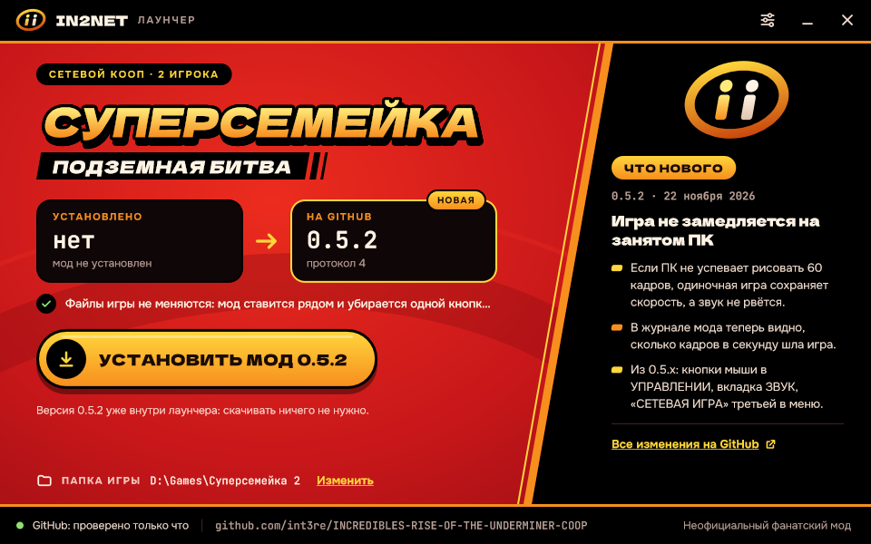

# Установка, обновление и удаление

[Документация](README.md) · **Установка** · [Лаунчер](LAUNCHER.md) · [Сетевая игра](NETPLAY.md) ·
[Управление](CONTROLS.md) · [Настройки](SETTINGS.md) · [Если что-то не так](TROUBLESHOOTING.md)

**Русский** · [English](en/INSTALL.md)

## Что нужно

- **Windows 10 или 11.**
- **Своя копия игры**: русское издание для ПК «Суперсемейка: Подземная битва» (*The Incredibles:
  Rise of the Underminer*, 2005), с его `incrotu.exe`
  (SHA-256 `640aa7316d36218d4bd08173cba7c5bf79b374c8c7d96a069128be296c70f320`). Ни в репозитории, ни в
  релизах файлов игры нет.
- Для игры через Steam: запущенный клиент Steam и любой аккаунт. Покупать ничего не нужно.
- Для игры по адресу через интернет: порт UDP `47820`, доступный у хоста, или виртуальная сеть
  (Radmin VPN, Hamachi, ZeroTier).

> **Другое издание игры.** Мод знает один `incrotu.exe`. С любым другим файлом он ничего не меняет и ничего
> не включает: лаунчер говорит об этом при установке («incrotu.exe другого издания»), а игра идёт так, будто
> мода нет.

## Установка

1. Скачайте [`in2net-launcher.exe`](https://github.com/int3re/INCREDIBLES-RISE-OF-THE-UNDERMINER-COOP/releases/latest/download/in2net-launcher.exe).
   Это один файл размером около 4,6 МБ, мод лежит внутри него; сам он никуда не устанавливается и может
   лежать где угодно.
2. Запустите его. Если он не нашёл игру, нажмите **Изменить** и выберите папку, в которой лежит
   `incrotu.exe`.
3. Нажмите **УСТАНОВИТЬ МОД**. Интернет не нужен: файлы берутся из самого лаунчера.
4. Нажмите **ИГРАТЬ**.

<p align="center">
  
  
</p>

> Лаунчер не подписан сертификатом, поэтому Windows может показать окно «Система Windows защитила ваш
> компьютер». Нажмите **«Подробнее» → «Выполнить в любом случае»**. SHA-256 файла указан в
> `in2net-latest.json` каждого
> [релиза](https://github.com/int3re/INCREDIBLES-RISE-OF-THE-UNDERMINER-COOP/releases).

## Что куда кладётся

Всё кладётся рядом с `incrotu.exe`. Файлы самой игры не трогаются, и `incrotu.exe` на диске не меняется:
мод работает в памяти.

| Файл | Что это |
|---|---|
| `winmm.dll` | [Ultimate ASI Loader](https://github.com/ThirteenAG/Ultimate-ASI-Loader): загружает мод в игру. Если такой файл там уже есть, он остаётся и используется |
| `in2net.asi` | сам мод |
| `in2net.ini` | настройки мода, с пояснением к каждой. Если файл там уже есть, он остаётся |
| `steam_api.dll` | библиотека Steam (нужна только для игры через Steam) |
| `steam_appid.txt` | появляется сам при первом обращении к Steam |
| `in2net-README.md` | короткое описание на русском |
| `in2net-install.txt` | список файлов, которые поставил лаунчер; по нему лаунчер убирает именно их |

Что появляется позже, само:

| Файл или папка | Что это |
|---|---|
| `in2net.log` | журнал последнего запуска |
| `in2net-menu.log` | журнал запуска, из которого была начата сетевая игра |
| `in2net-coop\` | сохранения сетевых игр (прогресс хоста); ваши собственные сохранения не трогаются |

Собственные файлы лаунчера лежат вне папки игры: его настройки — в `%APPDATA%\in2net\launcher.ini`,
загрузки и копии настроек, сделанные перед изменением, — в `%LOCALAPPDATA%\in2net\cache`.

## Обновление

Запустите лаунчер. При каждом запуске он спрашивает у GitHub, какой релиз самый новый:

- новый **лаунчер** берётся сам: скачивается, сверяется по размеру и SHA-256, встаёт на место старого и
  запускается заново;
- новый **мод** предлагается кнопкой **ОБНОВИТЬ ДО …**. Ваш `in2net.ini`, ваши клавиши и ваши сохранения
  остаются.

Под двумя версиями лаунчер пишет, можно ли ещё играть с друзьями, у которых старая версия (тот же сетевой
протокол), или обновиться нужно всем.

<p align="center">
  
  
</p>

## Удаление

Лаунчер → настройки (значок с ползунками справа вверху) → вкладка **ЛАУНЧЕР** → **Удалить мод**, затем
**Точно удалить?** Убираются именно те файлы, что записаны в `in2net-install.txt`. Вручную: удалите
`winmm.dll` и `in2net.asi`.

## Без окна лаунчера

```
in2net-launcher.exe /install "C:\Games\Incredibles 2" /quiet
```

```
in2net-launcher.exe /uninstall "C:\Games\Incredibles 2" /quiet
```

Код выхода — 0, если всё сделано, и 2, если нет (в папке нет `incrotu.exe`, игра запущена). Без `/quiet`
результат показывается в сообщении.

## Вручную

Соберите мод ([Сборка](BUILDING.md)) или возьмите файлы из установленной копии и положите `winmm.dll`,
`in2net.asi`, `in2net.ini` и, для Steam, `steam_api.dll` рядом с `incrotu.exe`.
