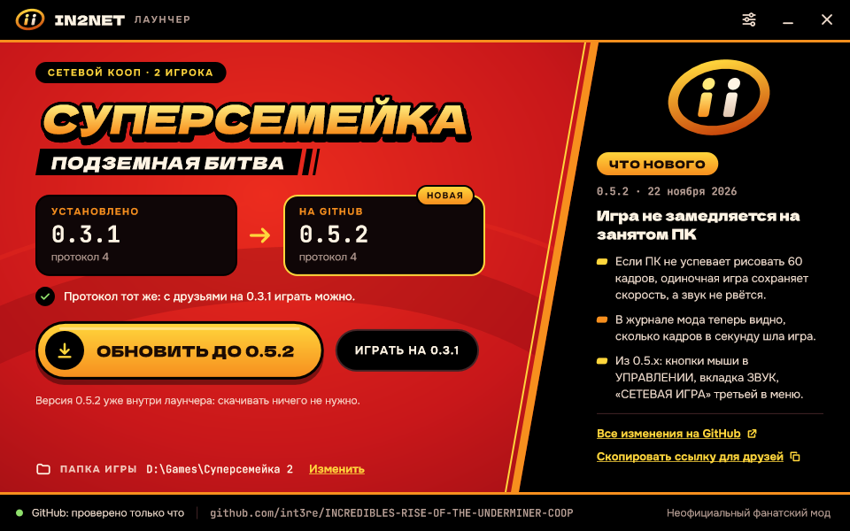
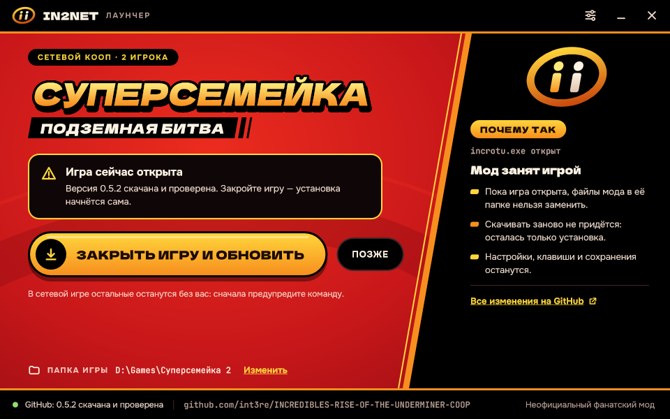
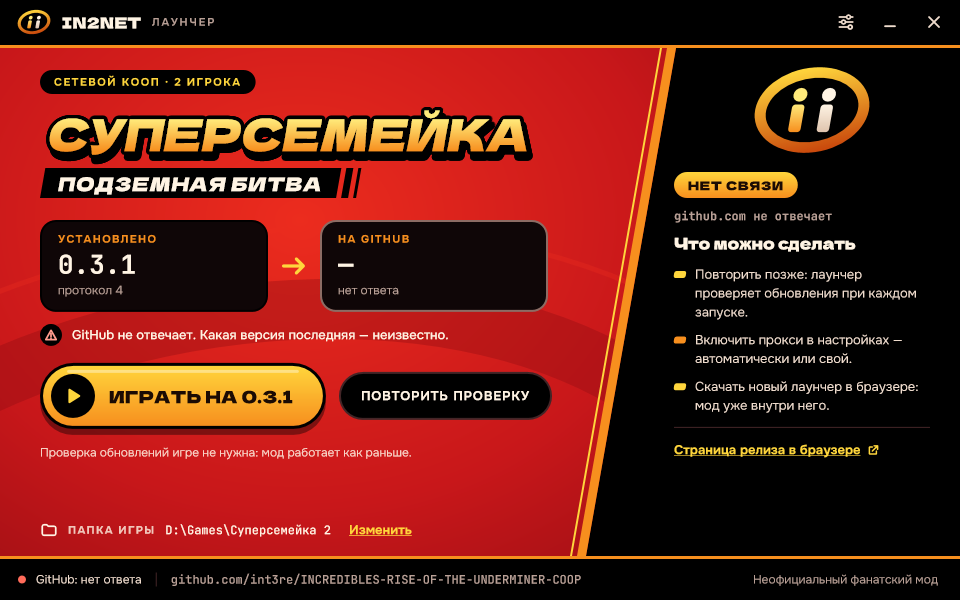
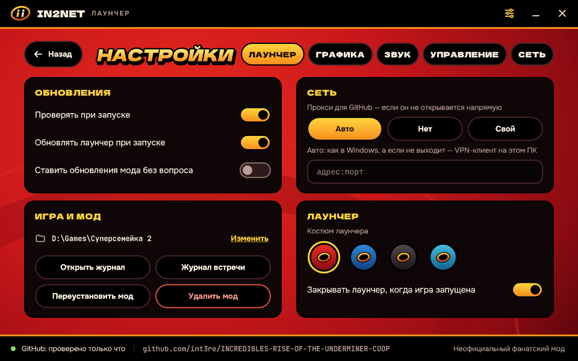
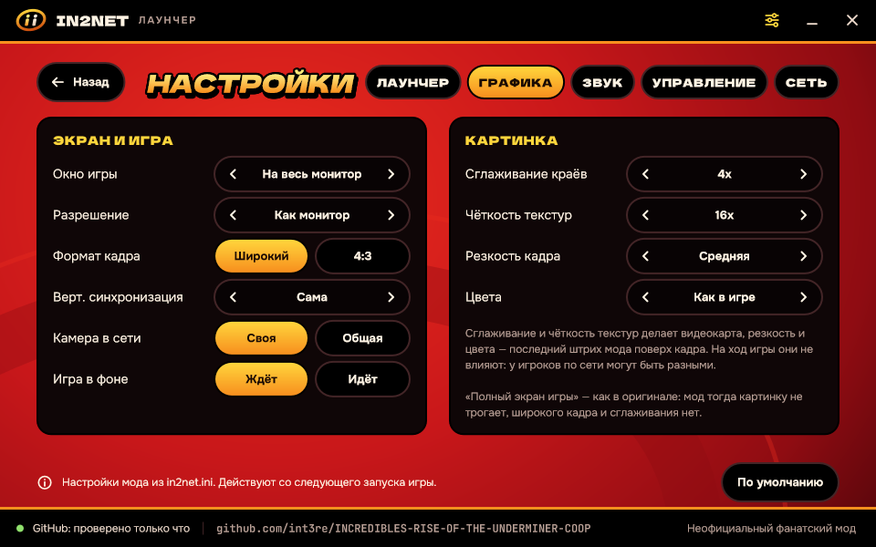

# Лаунчер

[Документация](README.md) · [Установка](INSTALL.md) · **Лаунчер** · [Сетевая игра](NETPLAY.md) ·
[Управление](CONTROLS.md) · [Настройки](SETTINGS.md) · [Если что-то не так](TROUBLESHOOTING.md)

**Русский** · [English](en/LAUNCHER.md)

`in2net-launcher.exe` — единственный файл, который получает игрок. Мод лежит внутри него. Лаунчер находит
игру, ставит мод и убирает его, обновляет мод и сам себя, настраивает картинку, звук, клавиши и сетевую игру
до запуска игры и запускает игру.

  

Это отдельная программа, а не часть игры: Direct2D и DirectWrite для картинки, WinHTTP для сети,
устанавливать ничего не нужно. Лаунчер не запускается вместе с Windows, не остаётся в фоне и не трогает
файлы игры. Оформление у него своё: костюм героев — красный, чёрный, жёлтый и оранжевый, — без логотипов
и персонажей фильма или игры.

## Главный экран

| Что написано на экране | Что делает большая кнопка |
|---|---|
| мод не установлен | **УСТАНОВИТЬ МОД**: ставит мод, который лежит в лаунчере; интернет не нужен |
| «У вас последняя версия» | **ИГРАТЬ** |
| пометка **НОВАЯ** у версии на GitHub | **ОБНОВИТЬ ДО …**; кнопка рядом, **ИГРАТЬ НА …**, запускает игру на той версии, что у вас стоит |
| GitHub не отвечает | запускает игру на той версии, что у вас стоит, или ставит мод из самого лаунчера; **ПОВТОРИТЬ ПРОВЕРКУ** спрашивает GitHub ещё раз |
| папка игры неизвестна | **ВЫБРАТЬ ПАПКУ ИГРЫ**: выберите папку с `incrotu.exe` |
| игра запущена | **ЗАКРЫТЬ ИГРУ И ОБНОВИТЬ** просит игру закрыться, как это делает крестик её окна; **ПОЗЖЕ** ждёт |

В двух рамках показаны версия, установленная в папке игры, и самая новая на GitHub, у каждой — её
**сетевой протокол**. Встретиться в сетевой игре можно только на версиях с одним протоколом; строка под
рамками словами говорит, можно ли ещё играть с друзьями, у которых старая версия.

Справа — что нового в версии, ссылка на все изменения на GitHub и **Скопировать ссылку для друзей** —
ссылка на самый новый релиз, для друзей.

  
  
  

  
  

## Обновления

При каждом запуске лаунчер запрашивает у GitHub файл `in2net-latest.json` самого нового релиза: версия и
протокол мода, заметки, имя файла лаунчера, его размер и SHA-256.

- **Новый лаунчер** сам встаёт на место старого: скачивается, сверяется по размеру и SHA-256, кладётся туда,
  где лежал старый, и запускается заново. Мод в папке игры при этом не трогается.
- **Новый мод** приходит внутри нового файла лаунчера. Файл скачивается в кэш лаунчера, проверяется и
  открывается как данные — он не запускается. Файлы мода достаются из него в папку игры.
- Файл с другим размером или другой контрольной суммой не используется.
- `in2net.ini`, клавиши игры и сохранения остаются при любом обновлении.

Обе проверки можно выключить в настройках. Без GitHub лаунчер всё равно ставит тот мод, что лежит в нём, и
запускает игру.

## Настройки

Значок с ползунками справа вверху. Пять вкладок; **По умолчанию** справа внизу возвращает строки вкладки к
исходным значениям.

### ЛАУНЧЕР — сам лаунчер

  

| Строка | Что она делает |
|---|---|
| **Проверять при запуске** | при каждом запуске спрашивать у GitHub, нет ли нового релиза |
| **Обновлять лаунчер при запуске** | новый лаунчер сам встаёт на место этого |
| **Ставить обновления мода без вопроса** | новый мод ставится при запуске, без кнопки |
| **Прокси для GitHub**: Авто / Нет / Свой | как добираться до GitHub, когда он не открывается напрямую: настройки самой Windows, а если не вышло — VPN-клиент на этом ПК; только напрямую; или свой HTTP-прокси `адрес:порт` |
| **Папка игры → Изменить** | выбрать другую папку с `incrotu.exe` |
| **Открыть журнал**, **Журнал встречи** | открыть `in2net.log` и `in2net-menu.log` из папки игры |
| **Переустановить мод** | положить файлы мода заново |
| **Удалить мод** | убрать именно то, что было поставлено |
| **Костюм лаунчера** | цвета лаунчера: красный, синий, тёмный, ледяной |
| **Закрывать лаунчер, когда игра запущена** | лаунчер закрывается, как только игра запустилась |

### ГРАФИКА — картинка

  

Окно, кадр и качество картинки: это настройки самого мода, они хранятся в `in2net.ini`. Каждая строка
описана на странице [Настройки](SETTINGS.md). На ход игры ни одна из них не влияет, поэтому у двух игроков
сетевой игры они могут быть разными.

### ЗВУК — звук

  

**Звуки** и **Музыка**, от 0 до 100 % с шагом 5. Это два ползунка самой игры — те же, что на её экране
ОПЦИИ; лаунчер меняет их там, где их хранит игра. В сетевой игре экран ОПЦИИ не открывается, так что
громкость для неё настраивается на этой вкладке.

### УПРАВЛЕНИЕ — клавиши и мышь

  
  

Клавиши обоих игроков, **ИГРОК 1** и **ИГРОК 2**. Это привязки самой игры, те же, что на её экране ОПЦИИ.

- **Клавиша:** нажмите на ячейку действия, затем на новую клавишу. Если клавиша занята другим действием,
  она меняется местами с той, что была у этого. Esc отменяет; сам Esc — это пауза и «назад» в игре, отдать
  его действию нельзя.
- **Кнопка мыши:** нажмите на ячейку действия, затем *на этой же ячейке* нажмите нужную кнопку — левую,
  правую, среднюю или одну из двух боковых. Действие получит кнопку в придачу к клавише; в ячейке тогда
  написано, например, `O / ЛКМ`. Повторное нажатие той же кнопкой на ячейке её убирает.
- **По умолчанию** возвращает показанному игроку клавиши самой игры и убирает его кнопки мыши.

Подробнее — на странице [Управление](CONTROLS.md).

### СЕТЬ — сетевая игра

  

Как встречаются два игрока (Steam и адрес, только Steam, только адрес), кто видит игру, созданную через
Steam (друзья или все, у кого стоит мод), и задержка ввода. Подробнее — на странице
[Сетевая игра](NETPLAY.md).

## Когда GitHub не открывается

Лаунчер по очереди пробует то, что разрешает строка **Прокси для GitHub**. При **Авто** это настройки
прокси самой Windows, прямое соединение и локальный прокси VPN-клиента на этом ПК, если такой слушает.
Строка внизу окна говорит, какой путь сработал. Если не приходят только файлы релиза (страница отвечает, а
сервер загрузок — нет), лаунчер так и говорит и предлагает открыть страницу релиза.

## Где лаунчер хранит своё

| Путь | Что там |
|---|---|
| `%APPDATA%\in2net\launcher.ini` | настройки лаунчера |
| `%LOCALAPPDATA%\in2net\cache` | скачанные релизы; `in2net.ini.before-launcher` и `keys.before-launcher.txt` — настройки мода и клавиши игры, какими они были до того, как лаунчер впервые за запуск их изменил |

## Из командной строки

| Команда | Что она делает |
|---|---|
| `in2net-launcher.exe /install "<папка игры>" [/quiet]` | ставит мод; код выхода 0 или 2 |
| `in2net-launcher.exe /uninstall "<папка игры>" [/quiet]` | убирает его |
| `in2net-launcher.exe --check --out <файл>` | спрашивает у GitHub самый новый релиз и записывает, что пришло |
| `in2net-launcher.exe --where --out <файл>` | записывает, где найдена игра и что там установлено |
