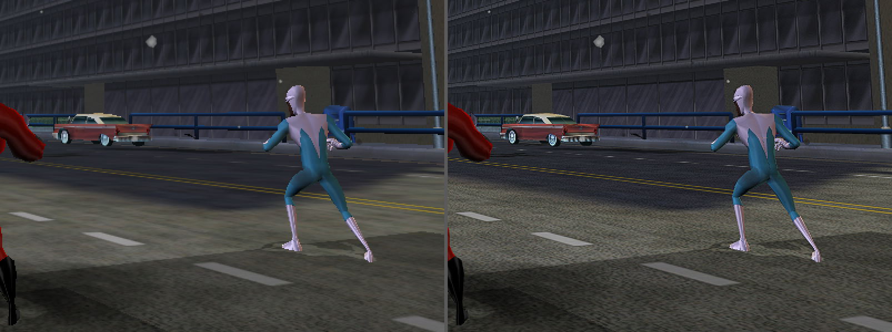
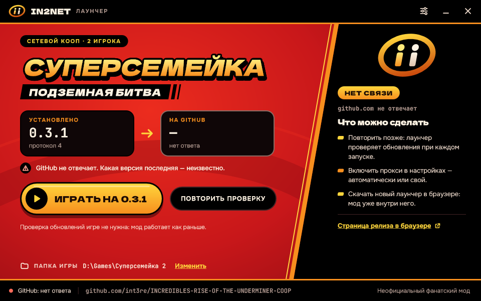

# Что добавлено и что изменено — в картинках

[Документация](README.md) · [Установка](INSTALL.md) · [Лаунчер](LAUNCHER.md) · [Сетевая игра](NETPLAY.md) ·
[Управление](CONTROLS.md) · [Настройки](SETTINGS.md) · [Если что-то не так](TROUBLESHOOTING.md)

**Русский** · [English](en/TOUR.md)

Все картинки сняты в лаборатории: имена игроков на них вымышлены.

## В игре

### Главное меню: один новый пункт

  

**СЕТЕВАЯ ИГРА** — третья кнопка, сразу под ДВА ИГРОКА. В игре здесь шесть кнопок; с модом их семь, и вместе
они ровно той же высоты, что картинка слева. Кнопка — такой же объект, как остальные: та же рамка, тот же
шрифт, та же подсветка и те же клубы пара, когда на неё переходит выделение.

В игре, которая уже идёт по сети, меню остаётся родным, без этого пункта.

### Страница сетевой игры

  

Страница, на которой встречаются два игрока. Она собрана из объектов страницы БОНУС самой игры: шесть строк
слева, рамка справа, подсказки внизу.

- Слева — что можно сделать сейчас: **СОЗДАТЬ ИГРУ**, **ИГРА: \<имя\>** (игра друга, найденная через Steam),
  **АДРЕС** (набрать адрес хоста), **НАЧАТЬ ИГРУ**, **ПРИГЛАСИТЬ** (друга из Steam), **ЗАКРЫТЬ ИГРУ**. Строки,
  в которых сейчас нет смысла, скрыты.
- Справа — кто уже здесь: игрок 1 и игрок 2 по именам, а у хоста ещё и адрес, который может набрать гость.

Подробнее: [Сетевая игра](NETPLAY.md).

### Сетевая игра: широкий кадр и своя камера

  

Экран игрока 2 в сетевой игре. Кадр — по форме монитора, по бокам видно больше, чем в родном 4:3; интерфейс
в углах сохраняет пропорции. Камера следит за героем этого игрока — герой игрока 1 виден вдали. На экране
игрока 1 всё наоборот, а игра под картинкой одна и та же.

### Картинка

  

Слева — как игра рисует сама, справа — со сглаживанием краёв, чёткими текстурами под углом и резкостью мода.
На ход игры это не влияет, поэтому каждый игрок ставит всё это по своему вкусу и по своей видеокарте.

## В лаунчере

### Одно окно на всё

  
  

Слева — первый запуск: мод лежит внутри лаунчера и ставится одной кнопкой. Справа — обычный вид: версия в
папке игры, последняя версия на GitHub, сетевой протокол каждой и что в ней нового.

  
  

Вышла новая версия: лаунчер пишет, можно ли по-прежнему играть с друзьями на старой, обновляет одной кнопкой
и сверяет скачанное по размеру и SHA-256.

  
  

Слева — GitHub не отвечает: играть всё равно можно, а мод ставится из самого лаунчера. Справа — настройки
самого лаунчера: обновления, прокси для GitHub, журналы, удаление мода и четыре «костюма» — цвета лаунчера.

### Настройки игры до её запуска

  
  

**ГРАФИКА** — окно, кадр и качество картинки. **ЗВУК** — громкость звуков и музыки самой игры.

  
  

**УПРАВЛЕНИЕ** — клавиши обоих игроков и, в придачу к клавише, кнопка мыши для действия: здесь толчок стоит
на левой кнопке, захват — на правой, а два суперудара — на боковых. Справа ячейка ждёт клавишу или кнопку.

  

**СЕТЬ** — как игроки встречаются, кто видит игру, созданную через Steam, задержка ввода и четыре шага, с
которых начинается сетевая игра.

Подробнее: [Лаунчер](LAUNCHER.md), [Настройки](SETTINGS.md), [Управление](CONTROLS.md).
