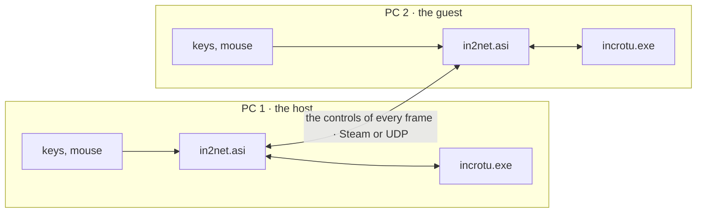

# How it works

[Documentation](README.md) · [Building](BUILDING.md) · [History](CHANGELOG.md)

**English** · [Русский](../ARCHITECTURE.md)

in2net is two programs: the **mod**, `in2net.asi`, which lives inside the game's process, and the
**launcher**, which never goes into the game at all.

## Getting into the game

- The game imports `winmm.dll` at its start. In the game's folder that name is
  [Ultimate ASI Loader](https://github.com/ThirteenAG/Ultimate-ASI-Loader), which loads `in2net.asi` and
  passes everything else on to Windows' own `winmm.dll`.
- `incrotu.exe` is packed: its code does not exist in memory when the mod is loaded. `boot.cpp` waits for
  the first call the game's own code makes, and only then puts the hooks in.
- The mod checks the SHA-256 of `incrotu.exe`. With a file it does not know it puts no hook in.
- Hooks are [MinHook](https://github.com/TsudaKageyu/minhook) trampolines (`patch.cpp`). Before a function
  of the game is hooked, its first bytes are compared with what they should be; if they are not, that
  feature is left to the game and the log says so. Nothing is changed on the disk.

The addresses and structures the mod uses are in one file, `src/mod/game.h`, each with a note.

## Time: the same on every computer

The engine steps its world by the real time a frame took and paces frames by itself (about 31 a second).
Two computers would never make the same steps. So the mod gives the game a clock of its own (`sim.cpp`):

- **A frame is 1/60 s.** The clock is the number of frames passed, nothing else. A frame is one pass of
  the engine's "read all pads" at the top of its loops — the mod's *frame gate*.
- **The mod holds the frames at 60 a second** itself; the engine's own limiter is taken out.
- A loop of the game that waits for the clock without passing the gate would wait for ever: after several
  thousand askings within one frame, every further asking moves the clock by a millisecond. The clock is
  still a function of what the game did, not of real time.
- A loop of the game that shows pictures without passing the gate — its settings screen — is held to 60
  pictures a second where the picture is shown.
- **Outside a network game** a frame that comes one to three sixtieths late takes them with it, so a
  computer that cannot draw 60 frames plays at the real speed with longer steps. In a network game the
  clock is never touched this way.
- The game's sounds end by the game's clock, not by the sound card's.

## A network game: lockstep

Each computer plays the whole game. Only the players' controls go over the network (`netplay.cpp`).

- At the frame gate each copy reads **its own player-1 controls**, sets them for the frame *now + input
  delay*, sends its last frames of controls, and waits for the other player's controls for the current
  frame. The host is player 1, the guest player 2.
- A packet carries every frame the other side has not acknowledged yet, so lost packets cost nothing but
  time.
- Every 30 frames the two copies compare a fingerprint of the game's state.
- A second thread keeps the connection alive while the game's own thread is busy for seconds (a level
  being loaded, a window being dragged).
- At the start the guest tells the host the fingerprints of its `incrotu.exe` and `data\in2.ini`; the
  host refuses a guest whose files differ. The host's shared saves are sent to the guest.

Transports (`src/common`): **ENet** over UDP for a game by address, **Steam Networking Messages** for a
game over Steam (through Valve's test application Spacewar, AppID 480), and a stand-in for Steam that the
lab uses to run two "Steam players" on one computer.

### What had to be made the same

Same controls give the same game only if nothing else differs. What the mod pins down:

- **The camera is a part of the logic.** What the camera sees decides what the game keeps active and how
  many random numbers its effects draw. So every computer computes with one and the same view (as tall
  as 4:3, as wide as 16:9), and its own view — the shape of its own frame, its own camera — is put in
  only while the frame is drawn (`camera.cpp`). The random number generator is saved over the drawing and
  restored after it.
- **Levels are loaded inside the frame** that asks for them. Left to itself, the engine shows a loading
  screen that runs frames on a second thread for as long as the disk takes — never the same number twice.
- **The mouse** moves the game's menu pointer, and the two players' mice differ: in a network game the
  game gets no mouse movement and no mouse messages. Buttons of the mouse bound to actions are told to
  the game by the mod (below).
- **The settings screen** is a loop of its own on one computer: it is not opened in a network game.
- **"Distance clipping"** of the display options changes what is computed: off for both.
- **Saves** of a network game are kept in a folder of their own.

## Controls

Once a frame, for every player, the engine asks one function for that player's gamepad state. The PC
port fills it from the keyboard, the mouse and the pads by the bindings in the registry. The mod sits on
that function (`input.cpp`): in a network game what the game is told for each player is what came over
the network.

For a control of the mouse the port asks another function, which knows three buttons. The mod answers
for the five buttons itself — as Windows holds them, while the game's window is in front and a level is
played. That makes the side buttons work and lets the buttons through in a network game, where the game
otherwise gets no mouse.

## The picture

- **A window instead of the exclusive full screen** (`video.cpp`): the device is made windowed, the
  window is placed without a frame over the monitor or as an ordinary one, the game's activation logic is
  kept away from minimizing it.
- **Any size of the frame**: the game is told the size the mod wants in place of its own list of modes.
- **Wide screen**: the view window is widened to the frame's shape; the 2D layer — the interface, the
  menus, the text — is squeezed back to its proportions, primitive by primitive (`hud.cpp`), and the
  3D parts of the interface with it.
- **Quality**: MSAA through the device's parameters; anisotropic filtering by changing the sampler states
  the game sets; a sharpening and colour pass over the finished frame just before it is shown
  (`postfx.cpp`, shader in `tools/postfx.hlsl`).

## The mod's menus are the game's own

The engine's menus are data: a pack of assets — frames, labels, pages, groups, links between them. The
mod makes no menu of its own (`gameui.cpp`). It hooks the three functions the engine finds assets with
and hands it more of them: copies of the game's own assets with other names, places and links.

- **The main menu**: СЕТЕВАЯ ИГРА is a copy of another button's frame and label; the game's own buttons
  are handed out as changed copies with new places and neighbours, so that seven rows fit where six were.
- **The network page** is a copy of the game's БОНУС page: the screen, six rows, the frame on the right,
  the hints, the group.
- The engine itself makes these objects, draws them, highlights them and walks them with the keys.
  `netpage.cpp` and `netlobby.cpp` put the words into the rows and act on what is chosen.
- **Messages** at the top of the frame are drawn by the game's own text drawing (`notice.cpp`).

The players meet on the page while both games are ordinary single games. When the host starts, each game
starts itself again with the session written into environment variables: a network game begins with the
process, before the game's first frame.

## Modules of the mod

| File | What it does |
|---|---|
| `dllmain.cpp`, `boot.cpp` | loading; waiting for the game's code; the start-up APIs |
| `patch.cpp` | hooks, checks of the bytes they go over |
| `config.cpp` | `in2net.ini` |
| `sim.cpp` | the clock, the frame gate, the pace, the frame log |
| `input.cpp` | the players' controls, the mouse, the lab's script |
| `netplay.cpp` | the network game: lockstep, checks, leaving |
| `netlobby.cpp`, `netpage.cpp` | meeting on the network page: Steam's lobby, the address, the start |
| `gameui.cpp` | the game's menu objects made for the mod |
| `notice.cpp` | messages in the game's font |
| `video.cpp` | the window, the device, the frame's size, shots |
| `camera.cpp` | the logic's view and the drawn one; the camera of one's own |
| `hud.cpp` | the 2D layer on a wide frame |
| `postfx.cpp` | sharpness and colours |
| `sound.cpp` | sounds by the game's clock |
| `saves.cpp` | the saves' folder of a network game |
| `diag.cpp` | crash reports into the log |

## The launcher

A program of its own: Direct2D and DirectWrite, WinHTTP, no dependencies; the fonts and the mod's files
are in its resources.

| File | What it does |
|---|---|
| `main.cpp` | the window, the mouse and the keyboard, the jobs, the command line |
| `view.cpp` | what is drawn: every screen from the model |
| `gfx.cpp` | Direct2D: shapes, gradients, text, PNG |
| `core.cpp` | the game's folder, the installed mod, the settings, the newest release |
| `package.cpp` | the mod inside a launcher file; putting it into the game's folder and taking it out by the list |
| `net.cpp` | HTTP, with or without a proxy |
| `gameset.cpp` | the rows of ГРАФИКА, СЕТЬ and ЗВУК: `in2net.ini` and the game's sound levels |
| `keys.cpp` | the rows of УПРАВЛЕНИЕ: the game's bindings in the registry |

A new version comes as a new launcher file: it is downloaded, checked by the size and SHA-256 the
release names, and **opened as data** — the mod's files are read out of its resources. It is run only
when it replaces the launcher itself.
