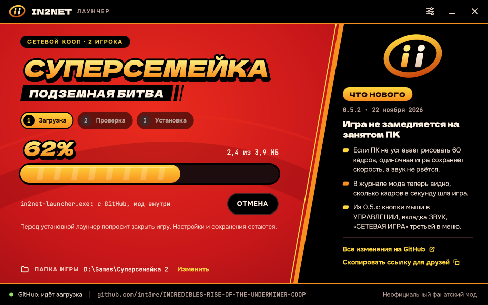
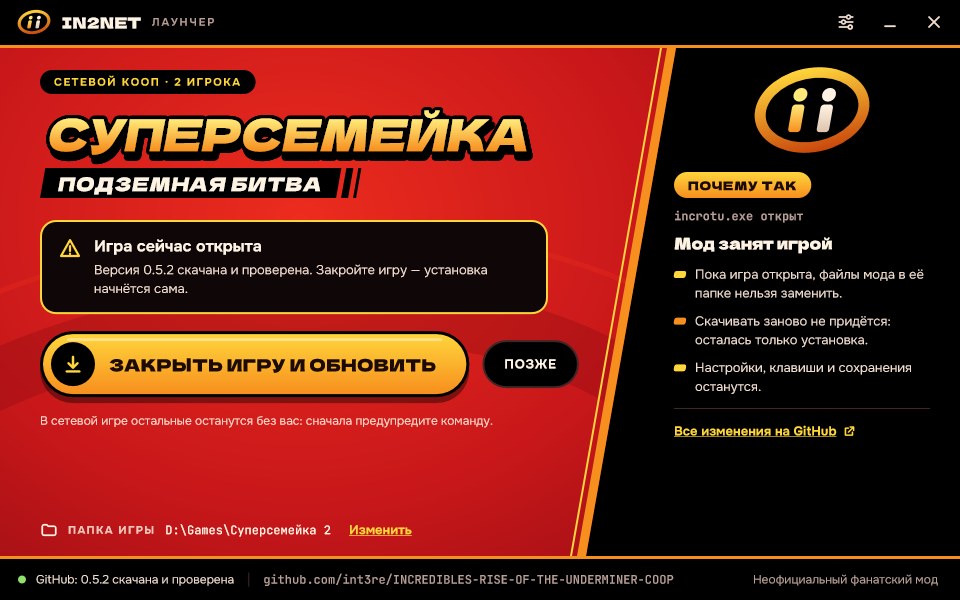
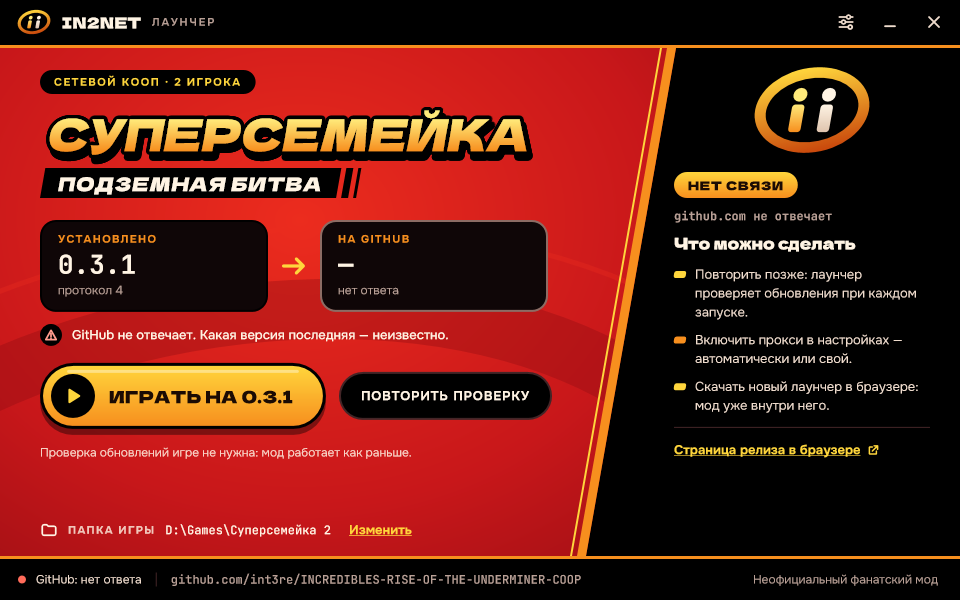
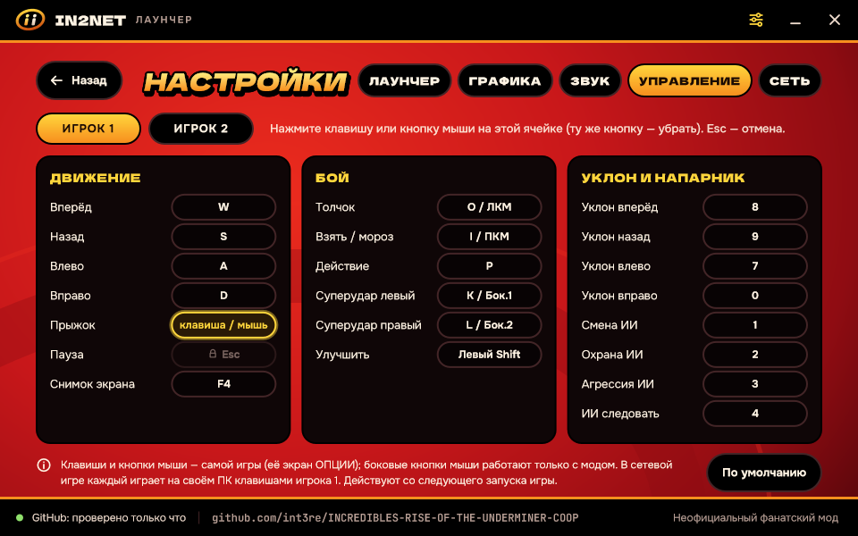

# The launcher

[Documentation](README.md) · [Install](INSTALL.md) · **Launcher** · [Network play](NETPLAY.md) ·
[Controls](CONTROLS.md) · [Settings](SETTINGS.md) · [Troubleshooting](TROUBLESHOOTING.md)

**English** · [Русский](../LAUNCHER.md)

`in2net-launcher.exe` is the one file a player gets. The mod is inside it. The launcher finds the game,
puts the mod in and takes it out, keeps the mod and itself up to date, sets the picture, the sound, the
keys and the network game before the game starts, and starts the game.

  

It is a program of its own, not a part of the game: Direct2D and DirectWrite for the picture, WinHTTP for
the network, nothing to install. It does not start with Windows, does not stay in the background and does
not touch the game's files. Its look is its own: the heroes' suit — red, black, yellow and orange — with
no logo or character of the film or the game in it.

## The main screen

| The screen says | What the big button does |
|---|---|
| the mod is not installed | **УСТАНОВИТЬ МОД** (Install the mod): puts in the mod the launcher carries; no internet needed |
| «У вас последняя версия» (you have the newest version) | **ИГРАТЬ** (Play) |
| the mark **НОВАЯ** (new) on the GitHub version | **ОБНОВИТЬ ДО …** (Update to …); the button beside it, **ИГРАТЬ НА …**, plays on the version you have |
| GitHub does not answer | plays on the version you have, or installs the mod from inside the launcher; **ПОВТОРИТЬ ПРОВЕРКУ** asks GitHub again |
| the game's folder is not known | **ВЫБРАТЬ ПАПКУ ИГРЫ**: choose the folder with `incrotu.exe` |
| the game is running | **ЗАКРЫТЬ ИГРУ И ОБНОВИТЬ** asks the game to close, as the cross of its window does; **ПОЗЖЕ** waits |

The two boxes show the version installed in the game's folder and the newest one on GitHub, each with its
**network protocol**. Players can meet in a network game only on versions with the same protocol; the
line under the boxes says in words whether friends on the older version can still be played with.

On the right is what is new in the version, a link to all the changes on GitHub, and
**Скопировать ссылку для друзей** — the link to the newest release, for friends.

  
  
  

  
  

## Updates

At every start the launcher asks GitHub for `in2net-latest.json` of the newest release: the mod's version
and protocol, the notes, the launcher file's name, size and SHA-256.

- **A newer launcher** takes the old one's place by itself: it is downloaded, checked by size and SHA-256,
  put where the old one was and started again. The mod in the game's folder is not touched by that.
- **A newer mod** comes inside the newer launcher file. The file is downloaded into the launcher's cache,
  checked, and opened as data — it is not run. The mod's files are taken out of it into the game's folder.
- A file with another size or checksum is not used.
- `in2net.ini`, the game's keys and the saves stay through every update.

Both checks can be turned off in the settings. Without GitHub the launcher still installs the mod it
carries and starts the game.

## The settings

The sliders icon at the top right. Five tabs; **По умолчанию** (Defaults) at the bottom right returns the
tab's rows to their defaults.

### ЛАУНЧЕР — the launcher itself

  

| Row | What it does |
|---|---|
| **Проверять при запуске** | ask GitHub for a newer release at every start |
| **Обновлять лаунчер при запуске** | a newer launcher takes this one's place by itself |
| **Ставить обновления мода без вопроса** | a newer mod is installed at the start without the button |
| **Прокси для GitHub**: Авто / Нет / Свой | how to reach GitHub when it does not open directly: Windows' own settings and, failing that, a VPN client on this PC; directly only; or your own HTTP proxy `address:port` |
| **Папка игры → Изменить** | choose another folder with `incrotu.exe` |
| **Открыть журнал**, **Журнал встречи** | open `in2net.log` and `in2net-menu.log` of the game's folder |
| **Переустановить мод** | put the files of the mod in again |
| **Удалить мод** | remove exactly what was put in |
| **Костюм лаунчера** | the launcher's colours: red, blue, dark, ice |
| **Закрывать лаунчер, когда игра запущена** | the launcher closes once the game is up |

### ГРАФИКА — the picture

  

The window, the frame and the quality of the picture: the mod's own settings, kept in `in2net.ini`. Every
row is described in [Settings](SETTINGS.md). None of them changes how the game plays, so two players of a
network game may have them different.

### ЗВУК — the sound

  

**Звуки** (sounds) and **Музыка** (music), 0 to 100 % by fives. These are the game's own two sliders — the
ones on its ОПЦИИ screen — changed where the game keeps them. A network game does not open the ОПЦИИ
screen, so this tab is the place to set the volume for it.

### УПРАВЛЕНИЕ — the keys and the mouse

  
  

The keys of both players, **ИГРОК 1** and **ИГРОК 2**. They are the game's own bindings, the ones on its
ОПЦИИ screen.

- **A key:** press the action's cell, then the new key. A key that another action has changes places with
  the one this action had. Esc cancels; Esc itself is the game's pause and "back" and cannot be given away.
- **A button of the mouse:** press the action's cell, then press the button you want — left, right, middle
  or one of the two side ones — *on that same cell*. The action gets the button besides its key; the cell
  then says, for example, `O / ЛКМ`. Pressing the same button on the cell again takes it off.
- **По умолчанию** returns the shown player's keys to the game's own and takes that player's mouse buttons off.

More in [Controls](CONTROLS.md).

### СЕТЬ — the network game

  

How the two players meet (Steam and an address, Steam only, an address only), who sees a game made over
Steam (friends or everybody with the mod), and the input delay. More in [Network play](NETPLAY.md).

## When GitHub does not open

The launcher tries, in turn, what the **Прокси для GitHub** row allows. With **Авто** these are Windows'
own proxy settings, a direct connection, and a VPN client's local proxy on this PC if one is listening.
The line at the bottom of the window says which way worked. If only the files of a release do not come
(the page answers, the download host does not), the launcher says so and offers the release's page.

## Where the launcher keeps its own

| Path | What |
|---|---|
| `%APPDATA%\in2net\launcher.ini` | the launcher's settings |
| `%LOCALAPPDATA%\in2net\cache` | downloaded releases; `in2net.ini.before-launcher` and `keys.before-launcher.txt` — the mod's settings and the game's keys as they were before the launcher first changed them in a run |

## From the command line

| Command | What it does |
|---|---|
| `in2net-launcher.exe /install "<game folder>" [/quiet]` | puts the mod in; exit code 0 or 2 |
| `in2net-launcher.exe /uninstall "<game folder>" [/quiet]` | takes it out |
| `in2net-launcher.exe --check --out <file>` | asks GitHub for the newest release and writes what came |
| `in2net-launcher.exe --where --out <file>` | writes where the game is found and what is installed there |
