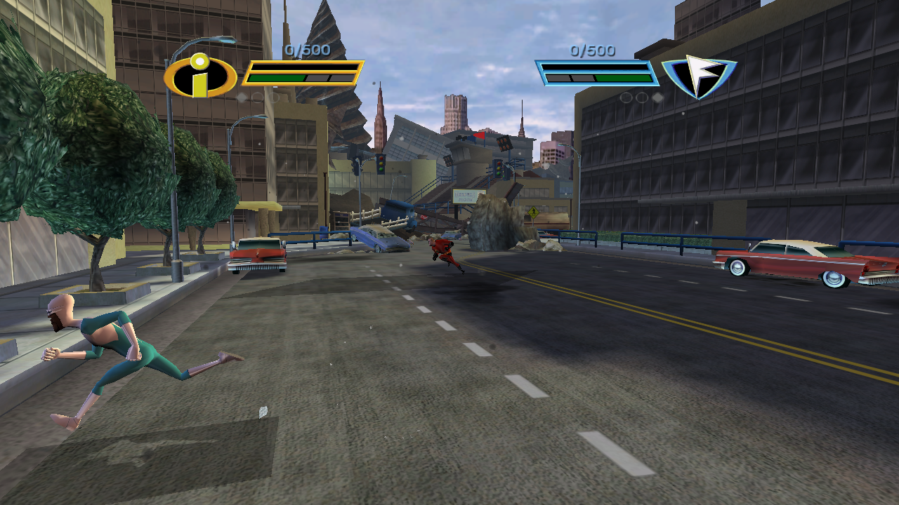

# Playing over the network

[Documentation](README.md) · [Install](INSTALL.md) · [Launcher](LAUNCHER.md) · **Network play** ·
[Controls](CONTROLS.md) · [Settings](SETTINGS.md) · [Troubleshooting](TROUBLESHOOTING.md)

**English** · [Русский](../NETPLAY.md)

The game has a mode for two, **ДВА ИГРОКА** (Two players), on one computer. in2net plays that same mode
over the network: each player has a copy of the game, a screen and a camera of their own. Player 1 is the
one who makes the game (the host), player 2 the one who joins (the guest).

   
  A network game on player 2's screen: a wide frame and a camera of their own.

## Before you start

- Both players have **the same game** — the same `incrotu.exe` and the same `data\in2.ini` — and versions
  of the mod with **the same network protocol** (the launcher shows it under each version). The host does
  not let in a guest whose files differ, and the guest sees why on the page.
- **Over Steam:** Steam is running at both players and they are friends in Steam. The game does not have
  to be in Steam: the mod uses Valve's free test application Spacewar (AppID 480), so Steam shows the
  status "Spacewar" during the game.
- **Without Steam:** the guest needs a direct way to the host over UDP, port `47820`: one local network, a
  port forwarded at the host's router, or a common virtual network (Radmin VPN, Hamachi, ZeroTier).
- Set the keys, the mouse's buttons and the volume beforehand, in the [launcher](LAUNCHER.md): the game's
  own ОПЦИИ screen is not opened in a network game.

## Starting a game

  
  

1. **Both** start the game as usual and choose **СЕТЕВАЯ ИГРА** (Network game) in the main menu — the
   third button, under ДВА ИГРОКА.
2. **The host** chooses **СОЗДАТЬ ИГРУ** (Make a game).
3. **The guest** joins:
   - *over Steam* — a row **ИГРА: \<the host's name\>** appears on the guest's page; choose it. The host
     can also send an invitation with the row **ПРИГЛАСИТЬ** (Invite; left and right change the friend);
     the guest accepts it while the СЕТЕВАЯ ИГРА page is open;
   - *by address* — put the highlight on the row **АДРЕС** (Address), type the host's address on the
     keyboard (the host sees it in the frame on the right) and press Enter.
4. When the second player is in — the name appears in the frame on the right — **the host** chooses
   **НАЧАТЬ ИГРУ** (Start the game). Both games close and open again a few seconds later, now in a
   network game.
5. In the main menu **player 1** chooses **ДВА ИГРОКА**, and the game goes on as it does for two.

| Row of the page | Who sees it | What it does |
|---|---|---|
| **СОЗДАТЬ ИГРУ** | everybody | opens your game for the second player |
| **ИГРА: \<name\>** | the guest | a friend's game found over Steam: join it |
| **АДРЕС** | the guest | type the host's address and press Enter |
| **НАЧАТЬ ИГРУ** | the host | start, once the second player is in |
| **ПРИГЛАСИТЬ** | the host | invite a Steam friend |
| **ЗАКРЫТЬ ИГРУ** | the host | close the game you made |

The page is made of the game's own menu objects: its frames, its font, its highlight, the same keys as in
its other menus.

### Without the menu

The older way still works: in `in2net.ini` the host sets `[net] mode = host`, the guest `mode = join` and
`connect = <the host's address>`, then both start the game. The host's game waits for the guest for up to
`wait` seconds. See [Settings](SETTINGS.md).

## In a network game

- **Each plays with their own "player 1" keys** on their own computer, whichever hero they play.
- **The pause is common.** Either player sets it, and the game stops for both.
- **The pointer of the mouse is off in the menus.** The game's menus follow the mouse, and the two
  players' mice are not the same — the games would part. The menus are walked with the keys. Buttons of
  the mouse given to actions work in a level.
- **The ОПЦИИ screen does not open.** It stops the game on one computer only.
- **There is no СЕТЕВАЯ ИГРА item in the menu.** To make another network game, start the game again.
- **A camera of your own.** Each player sees their hero in the middle and large. It can be turned off
  (ГРАФИКА → «Камера в сети»: «Общая») — the game then shows its one camera for both.
- **Messages at the top of the frame**, written by the game's own font: who you are in the game, that the
  other player has left, that the connection is lost.
- **The picture may differ.** Resolution, the shape of the frame, smoothing, sharpness and colours are
  each player's own: they do not change how the game plays. The draw distance is always full: it is a part
  of the game, not of the picture.
- **Saves are kept apart**, in the folder `in2net-coop` next to the game. The progress is the host's; it
  is sent to the guest at the start. Your own saves are not touched.

## When something goes wrong on the way

- **A long level load or a window being dragged** does not break the connection: the other player's game
  waits meanwhile.
- **If one player closes the game**, the other goes on alone at once. The same happens when the connection
  is lost for more than 15 seconds. A message at the top of the frame says so; the other player's hero
  stays where it stood.
- **While the other player's game is busy** (a long load), yours stands and waits. There is no message
  about it yet: no frame is drawn while the game waits.
- **A slow computer slows both.** The two games make every step together, so the game runs at the pace of
  the slower computer. (Alone, the game keeps its real speed on a slow computer.)

## How it stays the same on both computers

Nothing of the picture is sent. Each computer plays the whole game; only the players' controls go over
the network. A frame is not played until both players' controls for it have come, so the two games do the
same thing frame for frame. Twice a second they compare a fingerprint of the game's state. The delay
between pressing a key and the frame that uses it is the **input delay** (1 to 12 frames, 2 by default;
the host's value is the one in force): more of it is calmer on a poor connection, less is more responsive.

## Versions that play together

| Versions of the mod | Network protocol | Play together |
|---|---|---|
| 0.3.0 – 0.5.2 | 4 | yes |
| 0.2.1 | 3 | only with 0.2.1 |
| 0.2.0 | 2 | only with 0.2.0 |
| 0.1.0 | 1 | only with 0.1.0 |

## What has been checked and what has not

- Checked in the lab, on two copies of the game on one computer: games by address and through a stand-in
  for Steam, with loss, breaks of the connection and stalls; the two games' logs matched frame for frame
  in every run that is recorded in the [history](CHANGELOG.md).
- On a real Steam account the network page brings Steam up and makes a game for friends. **A whole game
  between two real accounts has not been played yet.**
- There is no joining a game that is already going, and no coming back after the connection is lost.
- Cut scenes and special scenes have not been checked in a network game.
