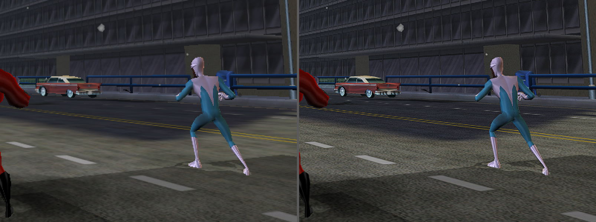
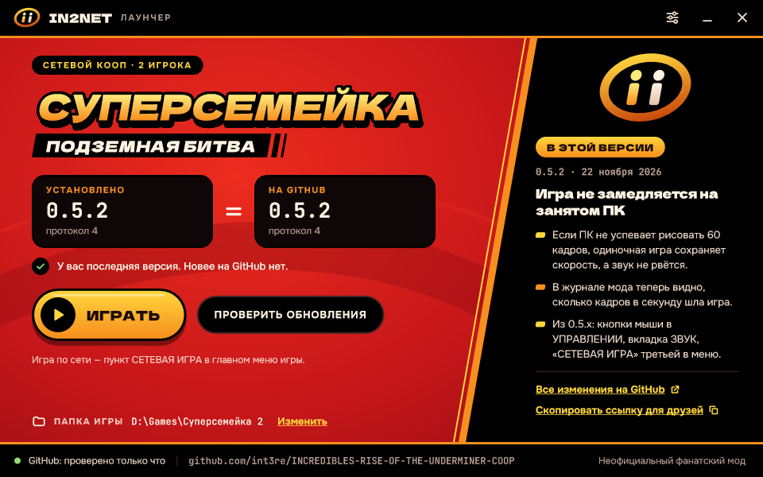
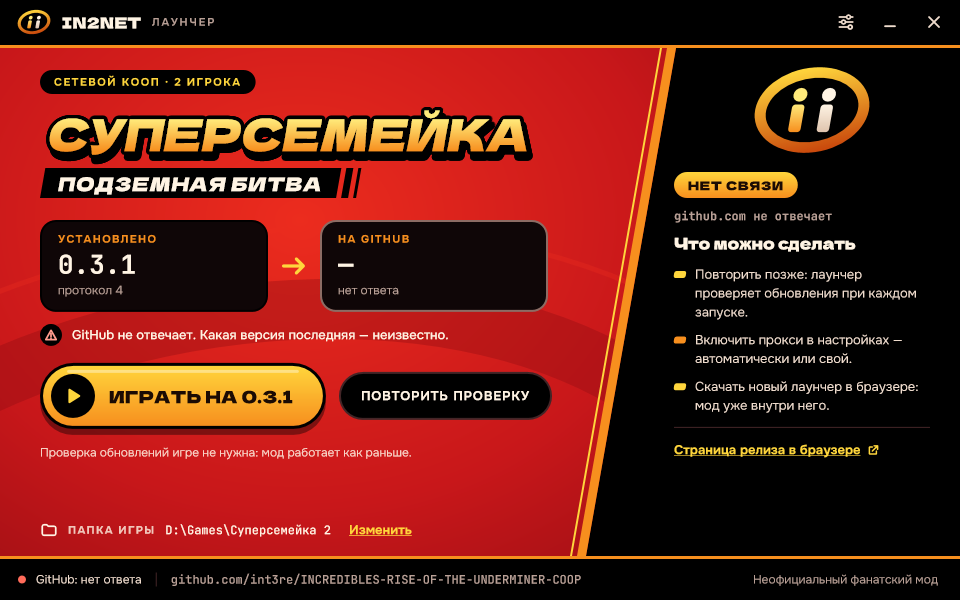

# What the mod adds and changes — in pictures

[Documentation](README.md) · [Install](INSTALL.md) · [Launcher](LAUNCHER.md) · [Network play](NETPLAY.md) ·
[Controls](CONTROLS.md) · [Settings](SETTINGS.md) · [Troubleshooting](TROUBLESHOOTING.md)

**English** · [Русский](../TOUR.md)

Every picture here was taken in the test lab: the players' names in them are made up.

## In the game

### The main menu: one new item

  

**СЕТЕВАЯ ИГРА** (Network game) is the third button, right under ДВА ИГРОКА (Two players). The game has
six buttons here; with the mod there are seven, and together they are exactly as tall as the picture on
their left. The button is the game's own kind of object: the same frame, the same font, the same
highlight and the same puffs of steam when it takes the focus.

In a game that is already a network one the menu is the game's own, without this item.

### The network page

  

The page where the two players meet. It is made of the objects of the game's own БОНУС (Bonus) page: six
rows on the left, a frame on the right, the hints at the bottom.

- On the left, what can be done now: **СОЗДАТЬ ИГРУ** (make a game), **ИГРА: \<name\>** (a friend's game
  found over Steam), **АДРЕС** (type the host's address), **НАЧАТЬ ИГРУ** (start), **ПРИГЛАСИТЬ** (invite a
  Steam friend), **ЗАКРЫТЬ ИГРУ** (close the game). Rows that make no sense at the moment are hidden.
- On the right, who is in: player 1 and player 2 by name, and for the host the address a guest can type.

More: [Network play](NETPLAY.md).

### A network game: a wide frame and a camera of one's own

  

Player 2's screen in a network game. The frame has the shape of the monitor, and more is seen at the
sides than in the original 4:3; the interface in the corners keeps its proportions. The camera follows
this player's hero — player 1's hero is in the distance. On player 1's screen it is the other way round,
and the game underneath is one and the same.

### The picture

  

On the left the game as it draws by itself; on the right with the mod's smoothed edges, sharp textures at
an angle and sharpening. None of it changes how the game plays, so each player sets it to their own taste
and their own video card.

## In the launcher

### One window for everything

  
  

On the left the first start: the mod is inside the launcher and goes in with one button. On the right the
everyday view: the version in the game's folder, the newest one on GitHub, the network protocol of each
and what is new.

  
  

A newer version: the launcher says whether friends on the older one can still be played with, updates
with one button, and checks what it downloaded by size and SHA-256.

  
  

On the left GitHub does not answer: the game can still be played and the mod installed from inside the
launcher. On the right the launcher's own settings: updates, a proxy for GitHub, logs, removing the mod,
and four "suits" — the launcher's colours.

### The game's settings before the game starts

  
  

**ГРАФИКА** — the window, the frame and the quality of the picture. **ЗВУК** — the game's own sound and
music levels.

  
  

**УПРАВЛЕНИЕ** — the keys of both players and, besides a key, a button of the mouse for an action: here
the punch is on the left button, the grab on the right one and the two super moves on the side buttons.
On the right a cell waits for a key or a button.

  

**СЕТЬ** — how the players meet, who sees a game made over Steam, the input delay, and the four steps of
starting a network game.

More: [The launcher](LAUNCHER.md), [Settings](SETTINGS.md), [Controls](CONTROLS.md).
